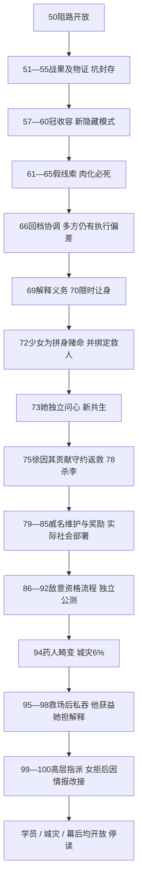

# 《待我拼好身体》第51—100章实证研究

陷阵营营长；book_id `7592279900040465433`；研究ID `N8_03`。新增正文仅51—100；前50章复用已验收0f250ea，不重拆、不覆盖。来源冻结718d853。逐章标题/行段/正文SHA256见[evidence](evidence/chapter-source-index.jsonl)。正文事实与角色推测分开；读者情绪是有行为证据的研究判断，置信度至多MEDIUM，不是读者测试。操作者徐墨、宿主白霏霏及盟友独立分账。

## 逐章实读：困境、选择、能力、反制与兑现

| 章 | 困境/选择与行动归属 | 能力分类、反制与实际结果 | 情绪、权责变化与未结问题 |
| --- | --- | --- | --- |
| [第51章 讲道理不听，那就换不讲道理的人来](https://github.com/xchhhh22222/nova-source-books/blob/718d853c01c165b4caa0bd0cd812311081578fe9/%E5%BE%85%E6%88%91%E6%8B%BC%E5%A5%BD%E8%BA%AB%E4%BD%93%EF%BC%8C%E6%97%A7%E6%97%A5%E9%87%8D%E4%B8%B4%E4%BA%BA%E9%97%B4%20-%20%E9%99%B7%E9%98%B5%E8%90%A5%E8%90%A5%E9%95%BF.txt#L7993) | 承接50末交涉破裂，明示徐墨上身；旧弱点刺中43级黄呈旧伤，对方撤开/招机关反击，万想控制局势但东区拉偏架 | 旧技巧/弱点，30级身体未自动无视高级敌；万为怕他被杀下意识加血液增幅，速度反应翻倍，是盟友能力非新外挂 | 威名使同僚不敢限制他，实际影响命令执行；保护者欲止杀却先增杀伤，开始承担帮凶压力。50归属UNKNOWN由51明确承接补证，原报告不改 |
| [第52章 你别谢我啊，好像是我帮你杀人一样](https://github.com/xchhhh22222/nova-source-books/blob/718d853c01c165b4caa0bd0cd812311081578fe9/%E5%BE%85%E6%88%91%E6%8B%BC%E5%A5%BD%E8%BA%AB%E4%BD%93%EF%BC%8C%E6%97%A7%E6%97%A5%E9%87%8D%E4%B8%B4%E4%BA%BA%E9%97%B4%20-%20%E9%99%B7%E9%98%B5%E8%90%A5%E8%90%A5%E9%95%BF.txt#L8137) | 徐利用突然增速杀黄，截断其摸戒指动作；万要求解释，徐允许查储物物品 | 旧知识/弱点＋盟友buff，未新增杀人经验。紫药剂实找到，少女认其与前矿区药相同；万救人意图却助完成杀人 | 罪恶反压→物证希望；他感谢辅助令万不安，调查/责任不是已经清算。药物在黄身已证，完整幕后链未证 |
| [第53章 你们的脑补令本邪神震惊](https://github.com/xchhhh22222/nova-source-books/blob/718d853c01c165b4caa0bd0cd812311081578fe9/%E5%BE%85%E6%88%91%E6%8B%BC%E5%A5%BD%E8%BA%AB%E4%BD%93%EF%BC%8C%E6%97%A7%E6%97%A5%E9%87%8D%E4%B8%B4%E4%BA%BA%E9%97%B4%20-%20%E9%99%B7%E9%98%B5%E8%90%A5%E8%90%A5%E9%95%BF.txt#L8293) | 徐要用被俘者验药，万阻人体实验并保人证；他未实施。黄姓使万推黄家，徐其实并不知其脑补；令炸地 | 新外挂未用；从人/物证转工程探查。定点爆破执行且地板裂，杨准备举盖；不算已经开全部核心区域 | 程序目的对抗即时暴力；盟友不是只惊讶，她改变俘虏处置。黄家整体罪责仍推断，不能把姓氏当全案证明 |
| [第54章 白霏霏，曙光城不会忘记你的恩德的！](https://github.com/xchhhh22222/nova-source-books/blob/718d853c01c165b4caa0bd0cd812311081578fe9/%E5%BE%85%E6%88%91%E6%8B%BC%E5%A5%BD%E8%BA%AB%E4%BD%93%EF%BC%8C%E6%97%A7%E6%97%A5%E9%87%8D%E4%B8%B4%E4%BA%BA%E9%97%B4%20-%20%E9%99%B7%E9%98%B5%E8%90%A5%E8%90%A5%E9%95%BF.txt#L8435) | 杨用言灵举盖，万为其加幅；发现巨量死尸。徐按旧尸潮出没经验试找源，自己也首次见坑 | 旧经验推位置＋他人工程能力，不是全知原早已掌握。阻黄投药切断一波潜在尸潮，未获矿底核心物 | 愤怒/后怕→守护认可，万鞠躬；少女也惊恐。救城有具体威胁被阻，不能以恩德赞词证明全城永久安全 |
| [第55章 特殊剧情触发，完成度30％](https://github.com/xchhhh22222/nova-source-books/blob/718d853c01c165b4caa0bd0cd812311081578fe9/%E5%BE%85%E6%88%91%E6%8B%BC%E5%A5%BD%E8%BA%AB%E4%BD%93%EF%BC%8C%E6%97%A7%E6%97%A5%E9%87%8D%E4%B8%B4%E4%BA%BA%E9%97%B4%20-%20%E9%99%B7%E9%98%B5%E8%90%A5%E8%90%A5%E9%95%BF.txt#L8571) | 面板提示特殊矿谜30%/奖励待定，徐从只战斗转愿查宝。众人需处理尸体，否决火烧煤矿，重水/封盖/护卫暂控 | 新展示的剧情进度界面，原游戏功能此前有而少用，未见解锁权限。尸体没全部永久处置；无任务奖励已到 | 万承诺上报/处理罪名尚计划；女孩道谢不等于事前授权报复。调查进度不等于城市获救比例。吴因上次付出被弃拒先测引新冲突 |
| [第56章 S级收容物，曙光城压箱底的禁忌](https://github.com/xchhhh22222/nova-source-books/blob/718d853c01c165b4caa0bd0cd812311081578fe9/%E5%BE%85%E6%88%91%E6%8B%BC%E5%A5%BD%E8%BA%AB%E4%BD%93%EF%BC%8C%E6%97%A7%E6%97%A5%E9%87%8D%E4%B8%B4%E4%BA%BA%E9%97%B4%20-%20%E9%99%B7%E9%98%B5%E8%90%A5%E8%90%A5%E9%95%BF.txt#L8725) | 徐持刀威胁吴停止抱怨，万按腕并安抚；吴用能力指路。徐为省操控时间还身体，女随队 | 清醒宿主控时仍有效；徐称吴问题只是看不顺眼/直觉，不作为已查实奸细。洪/李争S物撞队，威胁另来自第三方 | 威名变霸凌权并让万起初怀疑吴；没形成成本追责。骨饰证据逐件收集，S物为何在矿开启制度问题 |
| [第57章 序列S-079，时滞之冠！](https://github.com/xchhhh22222/nova-source-books/blob/718d853c01c165b4caa0bd0cd812311081578fe9/%E5%BE%85%E6%88%91%E6%8B%BC%E5%A5%BD%E8%BA%AB%E4%BD%93%EF%BC%8C%E6%97%A7%E6%97%A5%E9%87%8D%E4%B8%B4%E4%BA%BA%E9%97%B4%20-%20%E9%99%B7%E9%98%B5%E8%90%A5%E8%90%A5%E9%95%BF.txt#L8869) | 万虽疑内城罪恶仍帮李保城物；少女不知徐编组织如何回应，徐忙想抢冠无暇答；她独立拉叶避游骑兵袭击 | S-079冠被徐旧知识识别，是独立稀有物且概率遇到，未已有。敌两高阶/自己弱体使抢取困难 | 虚构威名留下具体社交信息债；护人行动由宿主主动，招揽并未让敌方低阶兵全停战。高级宝物强期待但没有资格取 |
| [第58章 面板的直接收容选项](https://github.com/xchhhh22222/nova-source-books/blob/718d853c01c165b4caa0bd0cd812311081578fe9/%E5%BE%85%E6%88%91%E6%8B%BC%E5%A5%BD%E8%BA%AB%E4%BD%93%EF%BC%8C%E6%97%A7%E6%97%A5%E9%87%8D%E4%B8%B4%E4%BA%BA%E9%97%B4%20-%20%E9%99%B7%E9%98%B5%E8%90%A5%E8%90%A5%E9%95%BF.txt#L9009) | 少女独立护叶、用旧弱点/模仿技巧战游骑兵；洪/李冲击破封，冠时间滞缓困所有人 | 物质运动慢、思维仍动；不是徐/少女暂停。界面出现直接收容选项，本章未满足/取得；敌公共能力也能误造成群体绝境 | 保护有叶感谢动作，敌误认职位卡级不是已证腐败。群战→动作失效/恐惧，抢宝目标变即时生存 |
| [第59章 点子王上线，卡bug](https://github.com/xchhhh22222/nova-source-books/blob/718d853c01c165b4caa0bd0cd812311081578fe9/%E5%BE%85%E6%88%91%E6%8B%BC%E5%A5%BD%E8%BA%AB%E4%BD%93%EF%BC%8C%E6%97%A7%E6%97%A5%E9%87%8D%E4%B8%B4%E4%BA%BA%E9%97%B4%20-%20%E9%99%B7%E9%98%B5%E8%90%A5%E8%90%A5%E9%95%BF.txt#L9167) | 冠需9999SAN，宿主97/100不足；回档可以逃但徐不愿放弃宝，想诱发隐藏状态，谎称出手会杀全部人 | 旧回档只作为备选未耗；隐藏状态锁SAN是19观察的推测用途，不新增借贷规则。旧知识不能硬破时滞 | 女守护目标与他取宝目标对冲；她求办法不是同意牺牲。操作者以信息优势设计她的恐惧，不能写成诚实协作 |
| [第60章 逗逗你的呀~不翼而飞！](https://github.com/xchhhh22222/nova-source-books/blob/718d853c01c165b4caa0bd0cd812311081578fe9/%E5%BE%85%E6%88%91%E6%8B%BC%E5%A5%BD%E8%BA%AB%E4%BD%93%EF%BC%8C%E6%97%A7%E6%97%A5%E9%87%8D%E4%B8%B4%E4%BA%BA%E9%97%B4%20-%20%E9%99%B7%E9%98%B5%E8%90%A5%E8%90%A5%E9%95%BF.txt#L9321) | 她拒以众人性命换冠、要求自己解决；谎言倒数诱发红瞳/踏步短挣脱。徐点收容，系统先失败重算后成功 | 19未明隐藏天赋再现并锁83SAN；已有收容入口＋隐藏条件卡bug绕9999门槛，非只有旧战术。直接收容禁用倒计时47:59:58，冠实入戒指，时滞解除 | 全员恢复动作是强生存结果，稀有资源实际到手；他享收益她检查叶安全，得知逗玩。没有显示借贷扣成负SAN，不能把类比“贷款”当真实代价 |
| [第61章 隐藏的强者，假面神隐会是真实存在的？](https://github.com/xchhhh22222/nova-source-books/blob/718d853c01c165b4caa0bd0cd812311081578fe9/%E5%BE%85%E6%88%91%E6%8B%BC%E5%A5%BD%E8%BA%AB%E4%BD%93%EF%BC%8C%E6%97%A7%E6%97%A5%E9%87%8D%E4%B8%B4%E4%BA%BA%E9%97%B4%20-%20%E9%99%B7%E9%98%B5%E8%90%A5%E8%90%A5%E9%95%BF.txt#L9481) | 两高阶找冠并互疑，万察少女曾早动、要求佩滤镜/弱者考虑退；女孩藏红瞳且护叶 | 冠已得但未主动作战使用；隐身份对猜后台提供外观。所有人停战不等于永久和好；隐强者/真实组织都是误推 | 旧假名声被真战果外观强化，宿主被两强者盯而怕失宝/曝戒指。没有正式加入或公开强者地位 |
| [第62章 什么叫我追踪我自己？](https://github.com/xchhhh22222/nova-source-books/blob/718d853c01c165b4caa0bd0cd812311081578fe9/%E5%BE%85%E6%88%91%E6%8B%BC%E5%A5%BD%E8%BA%AB%E4%BD%93%EF%BC%8C%E6%97%A7%E6%97%A5%E9%87%8D%E4%B8%B4%E4%BA%BA%E9%97%B4%20-%20%E9%99%B7%E9%98%B5%E8%90%A5%E8%90%A5%E9%95%BF.txt#L9611) | 洪谢救并要见前辈、李改称小姐求归还；女尴尬想他接管。吴吐血报冠去某方向，徐因知冠在戒里断定不老实 | 真冠位置反证追踪口径；探测伤势不自动保证内容真。三队按报告追，旧知识/信息差非新能力 | 名声提高礼遇却要求她兑现不存在组织/归还；收益变社会解释压力，但未见实际赔款/交冠。吴使路线改变，新敌策略不是只再挨骂 |
| [第63章 S级而已，不算什么东西](https://github.com/xchhhh22222/nova-source-books/blob/718d853c01c165b4caa0bd0cd812311081578fe9/%E5%BE%85%E6%88%91%E6%8B%BC%E5%A5%BD%E8%BA%AB%E4%BD%93%EF%BC%8C%E6%97%A7%E6%97%A5%E9%87%8D%E4%B8%B4%E4%BA%BA%E9%97%B4%20-%20%E9%99%B7%E9%98%B5%E8%90%A5%E8%90%A5%E9%95%BF.txt#L9779) | 女想告知万，徐阻止，明知吴欺诈仍想看下一线索；进度到40%。众人随假追踪到空洞，吴言语触负面情绪/新震动 | 冠已收不解除全部矿震，核心威胁另在；40%非全案完成。徐没来过这段地图，只以纹路联想某邪神 | 旧信息债变带队风险；女守护目标未改变他此处放任选择，她不放心却沉默。真假不能由“见识多”自动兜底 |
| [第64章 世上又不只我一个邪神，自爆卡车李鬼](https://github.com/xchhhh22222/nova-source-books/blob/718d853c01c165b4caa0bd0cd812311081578fe9/%E5%BE%85%E6%88%91%E6%8B%BC%E5%A5%BD%E8%BA%AB%E4%BD%93%EF%BC%8C%E6%97%A7%E6%97%A5%E9%87%8D%E4%B8%B4%E4%BA%BA%E9%97%B4%20-%20%E9%99%B7%E9%98%B5%E8%90%A5%E8%90%A5%E9%95%BF.txt#L9947) | 环境操纵全员暴躁，多方欲再战，万察血液异常；徐接管指出行为偏离、审吴，吴承认妻儿被威胁/最终仪式，李急漏销毁证据任务 | 旧经验＋当场行为推理/已知冠不在该处，非新增读心；吴与李口供新得，内奸不再只是56直觉；徐坦言未知地下源头 | 威名使众人愿停听，但全知神形象被女孩疑问挑战。利益/家庭胁迫推动敌选择，有反制主体；查得角色任务不等于抓全幕后 |
| [第65章 朝闻道夕死可矣，那我回档你不就炸了？](https://github.com/xchhhh22222/nova-source-books/blob/718d853c01c165b4caa0bd0cd812311081578fe9/%E5%BE%85%E6%88%91%E6%8B%BC%E5%A5%BD%E8%BA%AB%E4%BD%93%EF%BC%8C%E6%97%A7%E6%97%A5%E9%87%8D%E4%B8%B4%E4%BA%BA%E9%97%B4%20-%20%E9%99%B7%E9%98%B5%E8%90%A5%E8%90%A5%E9%95%BF.txt#L10147) | 吴揭黄/李家分工、上面可能还有人；徐延迟逃命换口供，洪逼问破局，砸地/李遁皆因墙肉化失效 | 准备回档未实际用；情报来自他人冲突而非永远早知。仪式空间收缩成真实必死局，两高阶常规手段失败 | 死前听真相只是短时信息支付；更深幕后UNKNOWN。女想救人焦急，徐仍享探索，不把口头朝闻道当接受死亡 |
| [第66章 回档，杀人，我宣布个事](https://github.com/xchhhh22222/nova-source-books/blob/718d853c01c165b4caa0bd0cd812311081578fe9/%E5%BE%85%E6%88%91%E6%8B%BC%E5%A5%BD%E8%BA%AB%E4%BD%93%EF%BC%8C%E6%97%A7%E6%97%A5%E9%87%8D%E4%B8%B4%E4%BA%BA%E9%97%B4%20-%20%E9%99%B7%E9%98%B5%E8%90%A5%E8%90%A5%E9%95%BF.txt#L10299) | 女求救；徐本已决定回档仍先换“情绪不违背、即使冒命危险要听”承诺。实际倒回半小时，再接管并杀吴、宣布带队 | 旧有限回档从几秒纠错扩为保留半小时新情报，消耗一次但本章未报余数；不是首次新增回档。女也留记忆，其他人忘；没有避开整片危险 | 她守护动机促交易内容，不证明他原先不想回档：65已计划。徐拿到服从许可，女主动接受但在胁迫信息下；救全队仍需之后验证 |
| [第67章 开了预知挂的老资历](https://github.com/xchhhh22222/nova-source-books/blob/718d853c01c165b4caa0bd0cd812311081578fe9/%E5%BE%85%E6%88%91%E6%8B%BC%E5%A5%BD%E8%BA%AB%E4%BD%93%EF%BC%8C%E6%97%A7%E6%97%A5%E9%87%8D%E4%B8%B4%E4%BA%BA%E9%97%B4%20-%20%E9%99%B7%E9%98%B5%E8%90%A5%E8%90%A5%E9%95%BF.txt#L10455) | 万令杨听安排；徐复述回档前口供压李，旧周目知识点洪接班人使其肯砸地 | 两种旧信息分别归因：本次回档得阴谋、旧经历知后继；指令需万担保/洪担心后继，非界面自动指挥所有人 | 从单体战果到多方行动权，身份有实际组织效果；但万问为何早不说，是新解释责任。砸地尚未成功，不计危机解除 |
| [第68章 年轻人们还是缺少和邪神打交道的经验](https://github.com/xchhhh22222/nova-source-books/blob/718d853c01c165b4caa0bd0cd812311081578fe9/%E5%BE%85%E6%88%91%E6%8B%BC%E5%A5%BD%E8%BA%AB%E4%BD%93%EF%BC%8C%E6%97%A7%E6%97%A5%E9%87%8D%E4%B8%B4%E4%BA%BA%E9%97%B4%20-%20%E9%99%B7%E9%98%B5%E8%90%A5%E8%90%A5%E9%95%BF.txt#L10603) | 地渐肉化、杨撑入口预警；洪普通拳不穿，经万buff/自身搏命言灵打穿，徐喊退李因疑抢宝反前上被绿物喷 | 徐做时序组织，真正破防是外人力量与代价，不是30级主角自打；回档情报没保证每人听令。徐立即杀一溅液者，原因本章尚待解释 | 生存方案有执行偏差与真实他人血雾成本；她问为何杀人，66救人保证不能提前全付。李猜抢宝的自主选择触后果，非主角控制所有决策 |
| [第69章 李鬼真成鬼，赴死者白霏霏](https://github.com/xchhhh22222/nova-source-books/blob/718d853c01c165b4caa0bd0cd812311081578fe9/%E5%BE%85%E6%88%91%E6%8B%BC%E5%A5%BD%E8%BA%AB%E4%BD%93%EF%BC%8C%E6%97%A7%E6%97%A5%E9%87%8D%E4%B8%B4%E4%BA%BA%E9%97%B4%20-%20%E9%99%B7%E9%98%B5%E8%90%A5%E8%90%A5%E9%95%BF.txt#L10745) | 女误以为他翻脸杀人，情绪使控制松动，徐不得不解释源气污染；万控血止其杀，徐改令游骑，洪明确让他们听，杀感染者 | 沾气者身/力异常增长提供证据；洪堵源但迟杀李，李化怪更强。操控时限临到；女心理影响控制、盟友限制动作都真实存在 | 承诺与杀人相斥产生解释义务，不能只记爽杀；救多数仍要牺牲感染者，66不算救所有。对命令服从由洪授权，不是主角万能领导 |
| [第70章 让我们进入邪神的身体](https://github.com/xchhhh22222/nova-source-books/blob/718d853c01c165b4caa0bd0cd812311081578fe9/%E5%BE%85%E6%88%91%E6%8B%BC%E5%A5%BD%E8%BA%AB%E4%BD%93%EF%BC%8C%E6%97%A7%E6%97%A5%E9%87%8D%E4%B8%B4%E4%BA%BA%E9%97%B4%20-%20%E9%99%B7%E9%98%B5%E8%90%A5%E8%90%A5%E9%95%BF.txt#L10905) | 徐问她能否立即睡，未成；援66险命服从协议，操控身体跳下洞即还她。源闭合/李停止长力，但李堵出口、伤杨，外队未全逃 | 清醒限时实际迫主体交替，睡眠不是随时可开。她按交易冒险，却未提前获目的/位置充分说明；跳落不摔伤是肉质地面 | 外人误读为牺牲，万自信其另有计划，非全体悲壮共识。她身体受险、他取得探查入口；外队生存继续开放 |
| [第71章 旧日邪神——真实世界](https://github.com/xchhhh22222/nova-source-books/blob/718d853c01c165b4caa0bd0cd812311081578fe9/%E5%BE%85%E6%88%91%E6%8B%BC%E5%A5%BD%E8%BA%AB%E4%BD%93%EF%BC%8C%E6%97%A7%E6%97%A5%E9%87%8D%E4%B8%B4%E4%BA%BA%E9%97%B4%20-%20%E9%99%B7%E9%98%B5%E8%90%A5%E8%90%A5%E9%95%BF.txt#L11071) | 女醒身看肉壁问所在，徐只推“真实世界”且也未知；旧黄家玉佩随环境发光，她取出试方向，按其提示寻心 | 旧战利品新导航；心脏虚实/生死尚推测。进度再增5点，可与63的40对照但不自行替面板编总数 | 保护人→探源恐惧/未知；徐说源闭合可给外人短时支撑，是判断未当永久安全。拼身材料入口尚待下一章自主选择 |
| [第72章 编造的组织这下成真了，白霏霏的觉悟](https://github.com/xchhhh22222/nova-source-books/blob/718d853c01c165b4caa0bd0cd812311081578fe9/%E5%BE%85%E6%88%91%E6%8B%BC%E5%A5%BD%E8%BA%AB%E4%BD%93%EF%BC%8C%E6%97%A7%E6%97%A5%E9%87%8D%E4%B8%B4%E4%BA%BA%E9%97%B4%20-%20%E9%99%B7%E9%98%B5%E8%90%A5%E8%90%A5%E9%95%BF.txt#L11269) | 女主动记得旧交易，问心能否作徐身体；他此前没想到用途、认为现阶硬拿危险，她决定赌命并要求死后救外人，他改同意试且允救她 | 宿主明确目标实际改变操作者思考/下一尝试，非他独算计划；不用冠的常规收容，因为心高位无对应仪式。她触心，引外部再震/李续变 | 她把偿债与守护绑定，不是利益无冲突；他也意外坚定。收益尚未到手，主动冒险先给外队增加压力，救助结果不能先支付 |
| [第73章 真实问心，我谁都不怨！](https://github.com/xchhhh22222/nova-source-books/blob/718d853c01c165b4caa0bd0cd812311081578fe9/%E5%BE%85%E6%88%91%E6%8B%BC%E5%A5%BD%E8%BA%AB%E4%BD%93%EF%BC%8C%E6%97%A7%E6%97%A5%E9%87%8D%E4%B8%B4%E4%BA%BA%E9%97%B4%20-%20%E9%99%B7%E9%98%B5%E8%90%A5%E8%90%A5%E9%95%BF.txt#L11443) | 外队要等她，洪燃生命扛化身级李、万保同僚；心诱少女以怨恨换力，她以自身价值拒。徐断连接/不能操控、准备回档但未用 | 隐藏锁SAN在降到1时再现，眉心强光护精神使空间崩；保护来源未详。面板给暂共生/世界之心勋章，是新增奖励而非纯旧战术 | 她独立意志完成试验，操作者不知道经历，不能把面板“您通过”归徐本人。外队的持守是取心前提/时窗；多线同时付实代价 |
| [第74章 从未如此美妙的开局！](https://github.com/xchhhh22222/nova-source-books/blob/718d853c01c165b4caa0bd0cd812311081578fe9/%E5%BE%85%E6%88%91%E6%8B%BC%E5%A5%BD%E8%BA%AB%E4%BD%93%EF%BC%8C%E6%97%A7%E6%97%A5%E9%87%8D%E4%B8%B4%E4%BA%BA%E9%97%B4%20-%20%E9%99%B7%E9%98%B5%E8%90%A5%E8%90%A5%E9%95%BF.txt#L11637) | 新心虚影贴宿主心位，少女只提醒记承诺后深睡；徐自动接管/取新感知勋章和言灵，称开局最好 | 勋章听心跳破潜行是新增能力，未本章实测；心变黑与操作者链接，言灵末已发但效果未验。面板32/SAN1锁，先说清零矛盾，30→32未给明确补升节点 | 拼身得到核心候选材料/宿主暂共生，非徐独立实体已重塑；他夸矿事解决不替任务/救城结算。深睡使此前临到控时转不限控，责任暂落他继续兑现 |
| [第75章 救场，席卷的黑色风暴](https://github.com/xchhhh22222/nova-source-books/blob/718d853c01c165b4caa0bd0cd812311081578fe9/%E5%BE%85%E6%88%91%E6%8B%BC%E5%A5%BD%E8%BA%AB%E4%BD%93%EF%BC%8C%E6%97%A7%E6%97%A5%E9%87%8D%E4%B8%B4%E4%BA%BA%E9%97%B4%20-%20%E9%99%B7%E9%98%B5%E8%90%A5%E8%90%A5%E9%95%BF.txt#L11799) | 徐试言灵黑甲，从心吸力但主动止再增怕身体炸；明确记她救人承诺返回上层。洪/万/杨快透支，徐逐一移开碎石攻击目标 | 新心奖励/言灵赋高身体能力，不是32级旧体纯技巧；这一次攻击无伤亡、叶与队友获实救，前感染死者未复活 | 少女目标成为他所得之后真实履约行动，他以她贡献作为回报动机。身体承载仍是限制；同伴持守给归返时间，不能只记主角单方神救 |
| [第76章 拿化身级畸变练手？](https://github.com/xchhhh22222/nova-source-books/blob/718d853c01c165b4caa0bd0cd812311081578fe9/%E5%BE%85%E6%88%91%E6%8B%BC%E5%A5%BD%E8%BA%AB%E4%BD%93%EF%BC%8C%E6%97%A7%E6%97%A5%E9%87%8D%E4%B8%B4%E4%BA%BA%E9%97%B4%20-%20%E9%99%B7%E9%98%B5%E8%90%A5%E8%90%A5%E9%95%BF.txt#L11961) | 旁人误认黑甲为组织高人，万找少女不见；李受源气压迫。徐拒洪帮，选择拿化身怪试能力 | 新甲抗碎石、新黑气凝矛＋旧技巧/勋章避攻击；尚未杀李，敌继续反抗。黑甲不被万探心跳是观察，不能直接判无心跳 | 救人→身份造势/练手，个人目的又延迟结束；暂把真正宿主身份藏起来，不说明组织真有第二高人 |
| [第77章 时滞！最残忍的处刑](https://github.com/xchhhh22222/nova-source-books/blob/718d853c01c165b4caa0bd0cd812311081578fe9/%E5%BE%85%E6%88%91%E6%8B%BC%E5%A5%BD%E8%BA%AB%E4%BD%93%EF%BC%8C%E6%97%A7%E6%97%A5%E9%87%8D%E4%B8%B4%E4%BA%BA%E9%97%B4%20-%20%E9%99%B7%E9%98%B5%E8%90%A5%E8%90%A5%E9%95%BF.txt#L12141) | 实攻力只近无遁术边缘行者，靠精神免疫/源气压制与技巧打场面五五；李再暴涨，徐为保组织逼格不得亮冠 | 60新得冠首次主动实战，范围万倍放慢众人，徐可动逐矛磨血；并非攻击可一击毙先知。围观者看凌迟而不知攻力不足 | 新威名制造维护成本：必须暴露稀有物与升级底牌，未因此失冠/资金。公开恐怖与旁人误读更强，不把形象高位当客观战力等级 |
| [第78章 这一口经验，将会很暴力](https://github.com/xchhhh22222/nova-source-books/blob/718d853c01c165b4caa0bd0cd812311081578fe9/%E5%BE%85%E6%88%91%E6%8B%BC%E5%A5%BD%E8%BA%AB%E4%BD%93%EF%BC%8C%E6%97%A7%E6%97%A5%E9%87%8D%E4%B8%B4%E4%BA%BA%E9%97%B4%20-%20%E9%99%B7%E9%98%B5%E8%90%A5%E8%90%A5%E9%95%BF.txt#L12315) | 徐怕负荷暗伤宿主加速杀；李实际死，解除冠。等级32→42一次10级达单次上限，任务99%仍缺1 | 旧异常击杀经验在新级差里暴增；新增一次10级上限明示。睡眠无限控未取消身体负荷；精神威压免疫/甲凝形效果实归新心 | 生存/成长强支付＋恐惧外观对冲，他舒爽其实经验非虐杀快感。洪礼谢承恩但回报未到。99%不能给任务奖励入账 |
| [第79章 老资历的疯狂编造，沉沦之黑！](https://github.com/xchhhh22222/nova-source-books/blob/718d853c01c165b4caa0bd0cd812311081578fe9/%E5%BE%85%E6%88%91%E6%8B%BC%E5%A5%BD%E8%BA%AB%E4%BD%93%EF%BC%8C%E6%97%A7%E6%97%A5%E9%87%8D%E4%B8%B4%E4%BA%BA%E9%97%B4%20-%20%E9%99%B7%E9%98%B5%E8%90%A5%E8%90%A5%E9%95%BF.txt#L12479) | 徐确认假会并编古组织、代号，洪撤队放弃提冠归还；万谢且答应接少女，徐借老师名开始新信息博弈 | 普通言语＋既有战果外观建立社会行动效果，不是新增GF；明确仍99%。同名组织有实际对外代理行为，不等于编造历史变真 | 从共同战斗到外部承情/传播；洪承诺以后回报尚欠。万获“少女还活”安心，他把她当传话接口；没有正式矿案全结 |
| [第80章 先知的震撼，答案之书暴露了？！](https://github.com/xchhhh22222/nova-source-books/blob/718d853c01c165b4caa0bd0cd812311081578fe9/%E5%BE%85%E6%88%91%E6%8B%BC%E5%A5%BD%E8%BA%AB%E4%BD%93%EF%BC%8C%E6%97%A7%E6%97%A5%E9%87%8D%E4%B8%B4%E4%BA%BA%E9%97%B4%20-%20%E9%99%B7%E9%98%B5%E8%90%A5%E8%90%A5%E9%95%BF.txt#L12675) | 徐说先知有答案书残页且可能借行动破徒弟死劫，请万带话；柳场景证实残页、万凶字消失，城市灾色淡，白疑加深 | 旧周目情报用于跨机构影响；答案书是NPC资源非主角新增外挂。组织/心脏事件实际被书记录，但不证明徐编出的古历史真 | 救人有独立观测补证，救城只风险降低；老师/徒弟信任进入新压力。第二纸先“灾”后写“凶”口径差保留，不能宣全城灾消。矿任务仍需后续最后1% |
| [第81章 剧情完美完成，新剧情开启！](https://github.com/xchhhh22222/nova-source-books/blob/718d853c01c165b4caa0bd0cd812311081578fe9/%E5%BE%85%E6%88%91%E6%8B%BC%E5%A5%BD%E8%BA%AB%E4%BD%93%EF%BC%8C%E6%97%A7%E6%97%A5%E9%87%8D%E4%B8%B4%E4%BA%BA%E9%97%B4%20-%20%E9%99%B7%E9%98%B5%E8%90%A5%E8%90%A5%E9%95%BF.txt#L12893) | 答案书传徐话让柳护“自家女孩”，她开机令接回；徐向万透露更高主使（其实复述吴），矿任务100%/完美，开启城灾1% | 明示结算：SAN上限100→300、同级体魄全面强化；A级物初始化未此章正式成品实用。新奖励，不是旧能力再用；他说书直接获消息与NPC场景互证 | 一个局部宏结果真支付，同时开更大危险；“迷雾一角”不等于幕后全查。丰厚新奖励促他愿做剧情，原本逃城立场开始改；完美是源面板评级，不是研究者质量评级 |
| [第82章 狼狈换身，我上天堂了？](https://github.com/xchhhh22222/nova-source-books/blob/718d853c01c165b4caa0bd0cd812311081578fe9/%E5%BE%85%E6%88%91%E6%8B%BC%E5%A5%BD%E8%BA%AB%E4%BD%93%EF%BC%8C%E6%97%A7%E6%97%A5%E9%87%8D%E4%B8%B4%E4%BA%BA%E9%97%B4%20-%20%E9%99%B7%E9%98%B5%E8%90%A5%E8%90%A5%E9%95%BF.txt#L13059) | 徐决定试城灾，也借女救世愿望；把救人恩情归女、指众人去接她，忘留时间只得狂奔绕路换身装昏。万/叶接走护她 | 旧操控、普通奔跑/扮晕＋新甲退形；无遁术限制使维护伪双身份有真实时间/曝露风险。新名声不等于真正有两副身体 | 承诺转他人抱歉/照护动作，妹背她、万担责而非只惊。悲壮外观含他主动夸大/归功，女本人尚在睡，不是知情领取所有社交结果 |
| [第83章 大大方方的，以后你就是曙光城的爹](https://github.com/xchhhh22222/nova-source-books/blob/718d853c01c165b4caa0bd0cd812311081578fe9/%E5%BE%85%E6%88%91%E6%8B%BC%E5%A5%BD%E8%BA%AB%E4%BD%93%EF%BC%8C%E6%97%A7%E6%97%A5%E9%87%8D%E4%B8%B4%E4%BA%BA%E9%97%B4%20-%20%E9%99%B7%E9%98%B5%E8%90%A5%E8%90%A5%E9%95%BF.txt#L13247) | 女醒问人安全和救城；徐夸危机提前/故意提离开诱她主动留，自己81—82已想新任务。她得知奖励后觉得绑定更深 | A-109凝视实到，消SAN1点/5秒群压，是新增物；冠、心、42级、300上限讲解不等于她全学会。说城灭时间提前尚无具体日期 | 女独立坚持不逃是真，但不是迫他首次改主意：他已打算试丰厚任务。收益与不自由感同时增长；“没人敢动”是他的夸口，不当通用免责法 |
| [第84章 那个组织，曾在历史上留下过足迹！](https://github.com/xchhhh22222/nova-source-books/blob/718d853c01c165b4caa0bd0cd812311081578fe9/%E5%BE%85%E6%88%91%E6%8B%BC%E5%A5%BD%E8%BA%AB%E4%BD%93%EF%BC%8C%E6%97%A7%E6%97%A5%E9%87%8D%E4%B8%B4%E4%BA%BA%E9%97%B4%20-%20%E9%99%B7%E9%98%B5%E8%90%A5%E8%90%A5%E9%95%BF.txt#L13417) | 洪向水瓶传消息，她借史传/答案书信号猜古组织真实，令洪留城附近追女；女也误推徐古代布局，他顺势采她“组织创始人”说法 | 社会信息外溢触第三方实际部署，非新增GF。历史足迹明确只是月的推测，被洪质疑；没有把组织古史查实 | 威名生成持续被观察的社会压力；徐玩弄猜测，女对自己角色渺小更焦虑。她的一句建议改外部包装，不等于改他行动主线 |
| [第85章 一路绿灯！清道夫等级测试](https://github.com/xchhhh22222/nova-source-books/blob/718d853c01c165b4caa0bd0cd812311081578fe9/%E5%BE%85%E6%88%91%E6%8B%BC%E5%A5%BD%E8%BA%AB%E4%BD%93%EF%BC%8C%E6%97%A7%E6%97%A5%E9%87%8D%E4%B8%B4%E4%BA%BA%E9%97%B4%20-%20%E9%99%B7%E9%98%B5%E8%90%A5%E8%90%A5%E9%95%BF.txt#L13587) | 万解释家族否认、替罪羊、老师止查；女身份已非罪人/入内籍，余额50万贡献1006，仍一级职级。她拒扬名、求危险工作，万先安排重测 | 官籍/钱点实付，与42体魄分开；家族究责未完成。旧恩情/后台开启入城，未自动给“英雄待遇”。女自主拒被保护闲职 | 资源认知差：万觉奖励少，她觉富足；想救城使她把私人收益降优先，实际要求任务。她自觉英雄不全归己，不抵消73独立问心事实 |
| [第86章 神通广大？我看是外城的来要饭了！](https://github.com/xchhhh22222/nova-source-books/blob/718d853c01c165b4caa0bd0cd812311081578fe9/%E5%BE%85%E6%88%91%E6%8B%BC%E5%A5%BD%E8%BA%AB%E4%BD%93%EF%BC%8C%E6%97%A7%E6%97%A5%E9%87%8D%E4%B8%B4%E4%BA%BA%E9%97%B4%20-%20%E9%99%B7%E9%98%B5%E8%90%A5%E8%90%A5%E9%95%BF.txt#L13759) | 柳录像承情/行方便但要求别宣假会；女想快测，万握力验证其强体并好胜。办事处李莉借赵嫉妒，设激怒/摄像抓把柄 | 先知保护是实际承诺有保密条件；体魄由新奖励支持，非新永久GF。本章试探已安排，未说陷阱成功/利益已失 | 矿胜利/族仇接制度反制，有具体人利益；保护不能取消低层不知详情。女不像徐只想借后台横走，下一冲突还是资格手续 |
| [第87章 她一直这么勇敢吗？不知道我是谁吗？](https://github.com/xchhhh22222/nova-source-books/blob/718d853c01c165b4caa0bd0cd812311081578fe9/%E5%BE%85%E6%88%91%E6%8B%BC%E5%A5%BD%E8%BA%AB%E4%BD%93%EF%BC%8C%E6%97%A7%E6%97%A5%E9%87%8D%E4%B8%B4%E4%BA%BA%E9%97%B4%20-%20%E9%99%B7%E9%98%B5%E8%90%A5%E8%90%A5%E9%95%BF.txt#L13931) | 女独自来预约被卡，徐醒欲借口开杀，她求自己处理；他以救城需近险任务理由接管。普通拳被罩挡，再用新心黑气破罩踹桌伤赵 | 本轮新心用于常态局部加强，无完整甲/冠；李录其违法重手作为既定计策。姓氏提示＋可见摄像，不当新增全知读心 | 威名未普遍落实，他需要重新立场；宿主意愿此处被压而非控制方向。与前办公室刁难→接管重手同形，新增变量是敌主动留录像 |
| [第88章 内城不比外城？老子还不比其他呢！](https://github.com/xchhhh22222/nova-source-books/blob/718d853c01c165b4caa0bd0cd812311081578fe9/%E5%BE%85%E6%88%91%E6%8B%BC%E5%A5%BD%E8%BA%AB%E4%BD%93%EF%BC%8C%E6%97%A7%E6%97%A5%E9%87%8D%E4%B8%B4%E4%BA%BA%E9%97%B4%20-%20%E9%99%B7%E9%98%B5%E8%90%A5%E8%90%A5%E9%95%BF.txt#L14109) | 徐发现反光摄像踹碎/伤李，她有内甲保命；主任51级先压后因柳和初过错服软。女求只预约，徐借救城要求现在测试见高层 | 普通观察/旧级别面板＋新心底力/已有后台；未正式杀两女（赵生死不知）。规矩担责由主任顾忌决定，而不是GF设免刑 | 恶意试探短时失败、测试入口获；主动扩冲突为剧情资源，不是此刻不闹就必死。她再被喝止，救城成为要求服从的理由 |
| [第89章 狂妄的闯入者，你脑袋怎么尖尖的](https://github.com/xchhhh22222/nova-source-books/blob/718d853c01c165b4caa0bd0cd812311081578fe9/%E5%BE%85%E6%88%91%E6%8B%BC%E5%A5%BD%E8%BA%AB%E4%BD%93%EF%BC%8C%E6%97%A7%E6%97%A5%E9%87%8D%E4%B8%B4%E4%BA%BA%E9%97%B4%20-%20%E9%99%B7%E9%98%B5%E8%90%A5%E8%90%A5%E9%95%BF.txt#L14293) | 主任为把风险甩给她而领入，家族高手施压，柳实际出声允许测；徐借机会见五名不稳高手，其等级跳54/51/59/58 | 新身份资源在资格流程落实，公共测试尚开头。旧界面识异数，不等于已知强化秘密或勋章正式检测到；本章未完成职业升阶 | 群体被骂/后台解围较重复，但高手/测试有主线入口。 原文先“李老”后“黄老”再李孟龙口径差保留，不合并两人罪责；新发现只开启解释期待 |
| [第90章 逼已经帮你装了，好好表现啊少女~](https://github.com/xchhhh22222/nova-source-books/blob/718d853c01c165b4caa0bd0cd812311081578fe9/%E5%BE%85%E6%88%91%E6%8B%BC%E5%A5%BD%E8%BA%AB%E4%BD%93%EF%BC%8C%E6%97%A7%E6%97%A5%E9%87%8D%E4%B8%B4%E4%BA%BA%E9%97%B4%20-%20%E9%99%B7%E9%98%B5%E8%90%A5%E8%90%A5%E9%95%BF.txt#L14453) | 徐据旧等级界面、尖颅外观及经验判断药剂；柳安排加压步行。徐还身体让女展示，普通四级极限后她仍顶压，心冒白光 | 判断非新探测天赋；宿主独立身体执行，操作者鼓励。白气为新心按主体表现的新现象，不能把测试步行归徐代打 | 资格压迫转自证，超过普通极限有实位移/汗痛。药物副作用由徐解释，当前尚未实证与矿药同源；下一章解释白气 |
| [第91章 不同的人，不同的心！](https://github.com/xchhhh22222/nova-source-books/blob/718d853c01c165b4caa0bd0cd812311081578fe9/%E5%BE%85%E6%88%91%E6%8B%BC%E5%A5%BD%E8%BA%AB%E4%BD%93%EF%BC%8C%E6%97%A7%E6%97%A5%E9%87%8D%E4%B8%B4%E4%BA%BA%E9%97%B4%20-%20%E9%99%B7%E9%98%B5%E8%90%A5%E8%90%A5%E9%95%BF.txt#L14619) | 徐见白气也惊讶，黑/白气对应不同心性；他以救城需信任及练肌肉催她走。女超过药人，后者受比较刺激/副作用再注药 | 新心宿主用法：向上意志下增强；没有额外系统解锁提示。女实际走，徐施动机压力；不能说她故意羞辱药人 | 她真喘累、对手自加风险，认可是结果竞争而非都只惊。她相信徐在帮自己，不完全知心的机制；过度拼命与药人加量成为事故前提 |
| [第92章 主角转换，百年难遇的天才？](https://github.com/xchhhh22222/nova-source-books/blob/718d853c01c165b4caa0bd0cd812311081578fe9/%E5%BE%85%E6%88%91%E6%8B%BC%E5%A5%BD%E8%BA%AB%E4%BD%93%EF%BC%8C%E6%97%A7%E6%97%A5%E9%87%8D%E4%B8%B4%E4%BA%BA%E9%97%B4%20-%20%E9%99%B7%E9%98%B5%E8%90%A5%E8%90%A5%E9%95%BF.txt#L14777) | 再注者超她十米后跌倒，柳禁补药。女走到80米跪下，徐叫停保身体；五分钟后白气迅速恢复，女旧弱点/实战技打碎影兵 | 新心恢复削弱疲劳约束；不是睡眠恢复或徐操控。柳造同级影兵属外部测试条件，女独立战果可观察；不等于正式五级职务已定 | 独立能力获公测承认，李想借短休让她输未成。快速恢复有新增能力依赖；夸天才/群体震惊连续出现，尚有结构疲劳 |
| [第93章 柳云的霸气，我是不是太好说话了？](https://github.com/xchhhh22222/nova-source-books/blob/718d853c01c165b4caa0bd0cd812311081578fe9/%E5%BE%85%E6%88%91%E6%8B%BC%E5%A5%BD%E8%BA%AB%E4%BD%93%EF%BC%8C%E6%97%A7%E6%97%A5%E9%87%8D%E4%B8%B4%E4%BA%BA%E9%97%B4%20-%20%E9%99%B7%E9%98%B5%E8%90%A5%E8%90%A5%E9%95%BF.txt#L14945) | 李与黄代表对眼，欲借梦魇测试伤女；柳先斥其报复，后出于探极限同意在旁守护。测试改项不是女自主选 | 柳的保护有真实制止行动，也有自己的好奇目标；B-094是机构资产非女金手指。没有所有测试者充分了解风险的授权过程 | 好后台不等于不制造压力；关系资源让她获机会也暴露更强精神风险。恶意刁难转事故前兆，未把柳定为幕后黑手 |
| [第94章 畸变！剧情进度突然增长？](https://github.com/xchhhh22222/nova-source-books/blob/718d853c01c165b4caa0bd0cd812311081578fe9/%E5%BE%85%E6%88%91%E6%8B%BC%E5%A5%BD%E8%BA%AB%E4%BD%93%EF%BC%8C%E6%97%A7%E6%97%A5%E9%87%8D%E4%B8%B4%E4%BA%BA%E9%97%B4%20-%20%E9%99%B7%E9%98%B5%E8%90%A5%E8%90%A5%E9%95%BF.txt#L15121) | 女SAN下降；第二针药人先畸变至63，柳封梦魇/撤压力，怪仍冲女。城灾进度1→6，徐见重要性主动强接管 | 宿主先抗精神、随后徐代打；心白转黑稳SAN是主体差异。进度增长是关联线索，未证明药剂与矿药同源或柳罪责 | 测试变生存/机构项目事故；女失控制却安心，当次依赖不等于授权98吞噬。徐为剧情收益接管，不能全归守护意图 |
| [第95章 古老者的凝视！全场跪拜的威压](https://github.com/xchhhh22222/nova-source-books/blob/718d853c01c165b4caa0bd0cd812311081578fe9/%E5%BE%85%E6%88%91%E6%8B%BC%E5%A5%BD%E8%BA%AB%E4%BD%93%EF%BC%8C%E6%97%A7%E6%97%A5%E9%87%8D%E4%B8%B4%E4%BA%BA%E9%97%B4%20-%20%E9%99%B7%E9%98%B5%E8%90%A5%E8%90%A5%E9%95%BF.txt#L15279) | 徐用83所得A-109压住突袭及四名将畸变者；威压波及记录员/先知，试命令让怪停再尝试自杀 | 旧物首次实战/压制特定混乱新畸变；SAN仍花费。只有弱势特定目标服令，不提升为永久“言出法随”通用能力 | 攻击停胸前、四人跪且血液变温顺为强可视结果，旁惊之外实际止袭/暂压感染；未说四人彻底治愈。威压也伤非敌旁人，不能当精准无成本守护 |
| [第96章 感谢你送来的人头；让我大胆胡说一下](https://github.com/xchhhh22222/nova-source-books/blob/718d853c01c165b4caa0bd0cd812311081578fe9/%E5%BE%85%E6%88%91%E6%8B%BC%E5%A5%BD%E8%BA%AB%E4%BD%93%EF%BC%8C%E6%97%A7%E6%97%A5%E9%87%8D%E4%B8%B4%E4%BA%BA%E9%97%B4%20-%20%E9%99%B7%E9%98%B5%E8%90%A5%E8%90%A5%E9%95%BF.txt#L15439) | 怪按命令自伤却未死，旧弱点亮后徐补踢；42→45，柳封数据/收尸。李诬她引畸变，徐提稀释矿药的猜测 | 旧压制物新控制用途＋旧勋章致命定位/经验结算；不是单句直接杀所有怪。公开药剂关联只是推测，借经验仍需后续检测 | 生存/成长真付；实验事故进入保密/责任争议，救场没洗清所有嫌疑。李家丢测试者是真损失，女未因此拿正式五级；新调查入口 |
| [第97章 勒索先知？这家伙长了几个脑袋](https://github.com/xchhhh22222/nova-source-books/blob/718d853c01c165b4caa0bd0cd812311081578fe9/%E5%BE%85%E6%88%91%E6%8B%BC%E5%A5%BD%E8%BA%AB%E4%BD%93%EF%BC%8C%E6%97%A7%E6%97%A5%E9%87%8D%E4%B8%B4%E4%BA%BA%E9%97%B4%20-%20%E9%99%B7%E9%98%B5%E8%90%A5%E8%90%A5%E9%95%BF.txt#L15605) | 徐质疑柳止查，盼她翻脸以解剧情，想错可回档；柳承难辞其咎但否认同一药/待查，进度仍6。徐索封口费 | 旧知识/回档作为风险后盾，此章未实际回档；怀疑与自述后备不是真相。威名使谈判可行，不是他已战胜79级先知 | 护城权威与救人关系进入信任危机；女不安，他谋奖励。柳认责任不认犯罪；未因大胆质疑就付清追责债 |
| [第98章 我就伸进去摸摸，不干别的](https://github.com/xchhhh22222/nova-source-books/blob/718d853c01c165b4caa0bd0cd812311081578fe9/%E5%BE%85%E6%88%91%E6%8B%BC%E5%A5%BD%E8%BA%AB%E4%BD%93%EF%BC%8C%E6%97%A7%E6%97%A5%E9%87%8D%E4%B8%B4%E4%BA%BA%E9%97%B4%20-%20%E9%99%B7%E9%98%B5%E8%90%A5%E8%90%A5%E9%95%BF.txt#L15761) | 索梦魇/要李死被拒，仅获触摸许可；徐借A-109反应偷吞特性，面板永久增强/添指定梦魇。还身体让女掩饰，柳疑未查出 | 明确新增吞噬关系和永久效果，不是既知物纯战术。柳授权触摸，不授权吞噬；女不知道他要偷，SAN/解释风险落她 | 徐实赚、女心虚、机构物遭异常特性损失形成对冲；损失影响范围/追责未明，不能说整城防线已瘫痪。没有现金封口费入账 |
| [第99章 令城主如雷贯耳的名字](https://github.com/xchhhh22222/nova-source-books/blob/718d853c01c165b4caa0bd0cd812311081578fe9/%E5%BE%85%E6%88%91%E6%8B%BC%E5%A5%BD%E8%BA%AB%E4%BD%93%EF%BC%8C%E6%97%A7%E6%97%A5%E9%87%8D%E4%B8%B4%E4%BA%BA%E9%97%B4%20-%20%E9%99%B7%E9%98%B5%E8%90%A5%E8%90%A5%E9%95%BF.txt#L15939) | 城主读保密报告，安排她任精英队战斗教师以休息/接上层；女自问药剂危险想告万，徐不知却装天机 | 名声在组织层产生实际任务指派；城主残腿为既往护城背景非本轮新牺牲。她知识少于他但药剂真相关两者都未知 | 威名生新责任/职业机会，未上任授课。秘书赞城主与主角疑权威对冲，不能把主观好人印象当洗罪证据；通知将到 |
| [第100章 当老师？那不是纯误人子弟嘛！](https://github.com/xchhhh22222/nova-source-books/blob/718d853c01c165b4caa0bd0cd812311081578fe9/%E5%BE%85%E6%88%91%E6%8B%BC%E5%A5%BD%E8%BA%AB%E4%BD%93%EF%BC%8C%E6%97%A7%E6%97%A5%E9%87%8D%E4%B8%B4%E4%BA%BA%E9%97%B4%20-%20%E9%99%B7%E9%98%B5%E8%90%A5%E8%90%A5%E9%95%BF.txt#L16111) | 正式四级暂定，五级行政不便为官方理由；万怀疑压纪录未证。女拒闲职想查药救城，万愿帮推；徐提供学院未来团灭旧情报，女改接 | 45体魄与四级职务分开；旧游戏记忆给新行动入口，非预言已成真/新增外挂。女主动提换任务有效进入办理，但决定最终受信息主导 | 职业升阶真付、五级认可部分欠；威名→教师责任已指派/接受，未实履责或利益牺牲。救城、学员死亡、药剂关联保持开放，停止于接受任务 |

## 五个阶段的连续判断

51—60：50章攻击主体由51明确“上身”补证；沿用旧弱点、盟友buff及外部爆破找到万人坑，第一轮物证/入口真实支付。世界并不任主角独力打开：杨撑石、万协调、两个高阶先到。冠的9999 SAN要求本来构成真实不可收容条件，但60靠新增显现的隐藏模式/锁SAN配合收容绕过，不能写成完全靠既有小技巧。特殊剧情只到30%，尸堆薄层封存不等于永久清危。

61—70：未知空间削弱老玩家全知，吴的误导让徐继续探；空间肉化时普通打穿/遁走失效。66回档实用旧能力，利用新口供组织多方脱困，但李不听退令、感染者不得不杀，救全队承诺并未完全支付。69宿主误会实际使控制松动，迫徐解释；70清醒控时到限且她不能立刻睡，早期约束此处仍有效。徐让她冒险跳下而未充分解释所在，风险与探查收益分属两人。

71—80：玉佩作为旧战利品接新环境导航，宿主记得拼身交易，使徐从“理论能作核心但现在危险”转为实际尝试。73她独立过问心，徐断连，不能抢归操作者；精神保护的确来源不明。74深睡释放控时，75新言灵/新心赋力返救，77冠实战、78杀李与升十级是强阶段支付。旧约束只保留身体承载/攻击力不足，其余多数靠新奖或隐藏保护跨越；不能称纯旧能力创新大高潮。80万生存有答案书旁证，城灾色淡只是缓解。

81—90：矿任务100%结算与官籍/钱点支付真实；85却明说家族未追到底。因此“主角拿矿任务奖”与“受害者得到全案正义”是不同合同。新威名导致绕路伪装、外势跟踪、敌家录像试探、高层放行测试等实际行为；以救城名义，徐压女处理意见。83她留城与他的奖励动机同向，不证明她此处改变他原本路线。办公室暴打—后台—群惊重现既有模式；公共测试将身份争执接回药剂线，才有变化。

91—100：女独立白心增力/恢复、公测战果与徐黑心接管/群压两种表现形成真正主体差异；95—96有阻袭、压感染与等级收益，反差不只靠旁人惊。94进度1→6将药剂事故接救城，却没有查实化学关联。97质疑权威后98吞噬赚资源，责任留给女，知情与授权债再增。100职业四级已付、教师任务已接，新社会责任刚启动；教学结果、利益损失、救城与调查清算不能提前结算。

## 主要循环：同一胜利如何改变下一问题

下表每行是研究窗口内实际链条；末节点标开放的循环不计为完整胜利。来源均为N8_03 / 7592279900040465433，章节逐条链接见上表。

| 循环与来源 | 困境/压力 → 自主选择 → 金手指用途 → 反制 → 翻盘 | 情绪、可见支付、状态 → 下一问题 | 原创功能与独立疲劳风险 |
| --- | --- | --- | --- |
| R1 51—55 地板下证据 | 高台拒通/怕爆矿 → 徐压住摸戒指敌人，外队爆破 → 旧弱点＋万buff，杨撑入口 → 人骨坑仍危及矿 → 封薄尸层/留证上报 | 压迫转黑幕恐惧；敌死亡、药剂/万人坑可见、任务30%，非全清 → 开始争冠/深探 | 暴力取得物证也取得保全负担；风险是以爆破总能找到正确秘密、旁证代价只嘴说 |
| R2 57—60 冠收容 | 群体时滞、正常成本9999远超97 → 徐宁留宝不回档并催女 → 面板收容＋未知锁SAN/新模式 → 首次失败再重算 → 冠入戒/时滞解除 | 必死静止转强资源跃迁；众人活、收容功能暂禁48h → 假高人误认/冠归属争议 | 获物取消一次灾效又添产权压力；风险是每次不够资源就触隐藏免付，不能作为有限预算母型 |
| R3 61—70 肉化绝境 | 假探测诱进、空间封闭无法普通逃 → 徐回档保情报，协调盟友破地/退 → 旧回档/知识 → 李争宝不听、源气感染、女不认杀人控制松 → 徐解释、分队授权、关闭源但跳入还身体 | 死惧转部分掌控再伦理惊惧；有执行方案及临时压源，感染者死亡/外队仍困 → 女接身体探索；开放子环 | 准备充分也受他人目标反制；风险是回档全知化、牺牲一笔带过。此处控制限时真实，没有全体获救结算 |
| R4 71—78 共生与返救 | 需拼身却弱体无仪式、外人快死 → 女主动冒险取心并要求救人，徐同意 → 旧玉佩导航、未知精神保护、新共生/言灵 → 问心拒怨、徐断连；李再涨、身体负荷 → 女独立成功，徐守约新甲返救、冠磨杀 | 恐惧/不怨/被回应→救助/成长；己方本次飞石救下、李死、32→42 → 组织人设需维护、矿任务仍99% | 受益者的要求改强者返程，双主体贡献有次序；风险是黑甲/冠连发免风险，将女只当开宝钥匙 |
| R5 79—85 名声结算 | 需要让他人接回女/任务差最后1% → 徐借旧书情报传柳、造双身份 → 旧知识＋说话/既有战果 → 无遁需绕路装昏、女睡未知 → 柳开机、众人照护、任务100及奖励官籍 | 他得意、他人承情、她忐忑；SAN300/体魄/A物、钱点/非罪身份实付 → 城灾1%、家族不追到底/外势跟踪 | 对不同人分别结算的胜利；风险是虚构背景自动被所有权威当真，后台无限免刑。伪史仍未查实 |
| R6 86—92 资格与独立验证 | 敌设摄像/资格卡、女需救城任务 → 徐接管破罩逼測后还身，女接受强压 → 新心黑气/白气＋旧技巧勋章 → 官流程与药人短休策略 → 女80米/影兵战果、白心恢复 | 憋屈→武力扬眉→她自身被看见；测试有实物/位移结果，仍未官升 → 加码梦魇测试 | 社交资源变验证入口，功绩不全由操作者；风险是群嘲—一拳—群惊复写，快速恢复把代价抹平 |
| R7 93—98 事故/收益/责任错位 | 梦魇＋补药畸变，女不能抗63 → 徐因剧情收益接管 → 新心黑气＋已有A物压制/命令、旧弱点补踢 → 旁人也受威压、李反指责任、柳止争 → 击杀42→45；只获摸物许可却偷吞新特性 | 生存/震撼→怀疑权威→他赚她心虚；数据保密、城灾6%、物永久增强 → 药剂检测/保密责任/补救未结 | 同救场不自动有盗公共物授权；风险是大胆胡说永获收益、SAN和后果只由他人付，反派反指无限循环 |
| R8 99—100 工作接力（开放） | 名声被高层看见、救城需时间 → 女拒闲教师，万答应推；徐以旧学院死讯改她选择 → 旧知识改变行动权 → 她没独立核验/信其必准 → 四级暂定与接受教师任务 | 被认可却怕害人；真实新职务责任已启动 → 教学、学员存亡/药剂关联未实演 | 一次认可把职责而非纯奖励交给当事人；风险是任何她的拒绝都被一条新情报迅速收服，所谓轻松工作每次皆危险 |

72→75有明确动机回指，94→城灾6%有面板关联；矿药→测试药同源则只有96—99推测，不能在图中连成已证因果。新增能力、责任分账、已付与欠付见[使用谱系](usage-lineage-1-100.md)、[情绪合同](emotion-arc-contracts.md)和[兑现及缺口](obligations-and-findings.md)。
