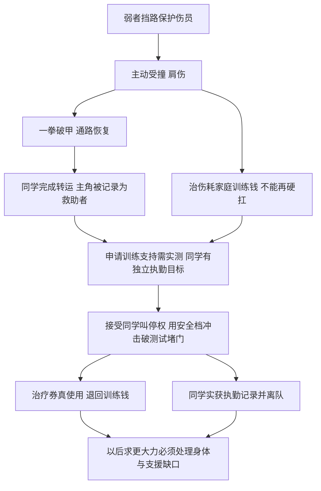
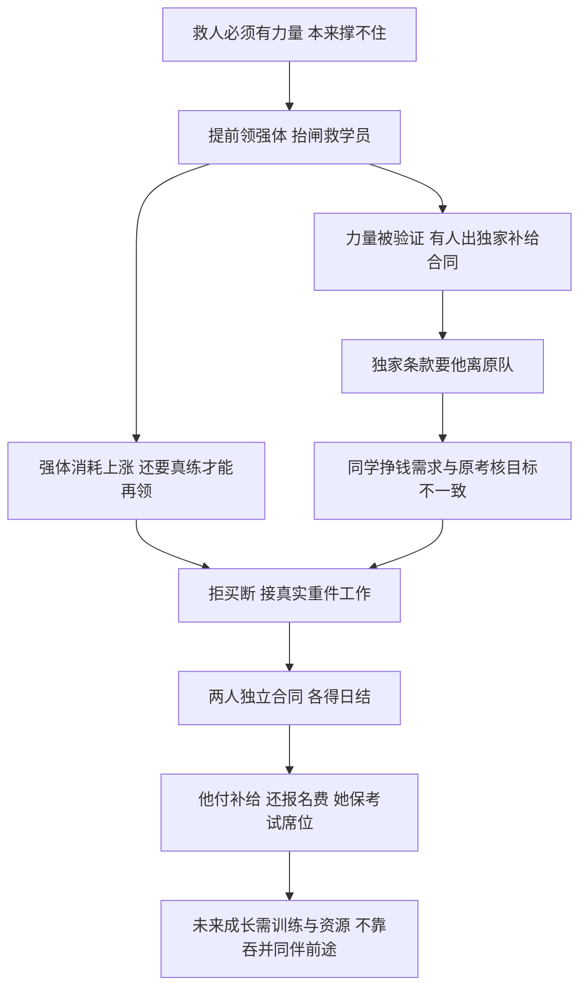
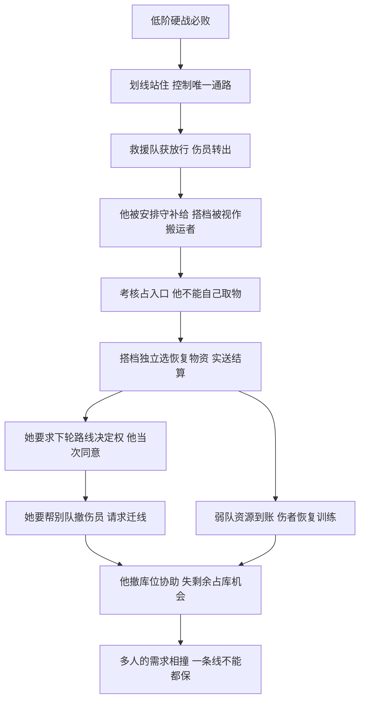

# 三组新的高爆发开篇融合试验

`【候选设定】`；独立原创都市高武故事试验，非《高武：我有无限技能》的设定、正文或最终章纲。只展示前10章两轮结果及情绪因果，不写正文，不推20—100章大纲。`CREATIVE_OPENING_QUALITY=PENDING_AUTHOR_REVIEW`。规则、数值和人物均未冻结，三案不自动打分、不自授文学PASS。

旧[A](https://github.com/xchhhh22222/novel-decomposition/blob/0f250ea375c61aaa7e9693924a89657a37618a3e/research/nova-three-stage2-2026-10-12/cross-book-emotion-fusion.md#L64)、[B](https://github.com/xchhhh22222/novel-decomposition/blob/0f250ea375c61aaa7e9693924a89657a37618a3e/research/nova-three-stage2-2026-10-12/cross-book-emotion-fusion.md#L80)、[C](https://github.com/xchhhh22222/novel-decomposition/blob/0f250ea375c61aaa7e9693924a89657a37618a3e/research/nova-three-stage2-2026-10-12/cross-book-emotion-fusion.md#L96)保持原字节；[哈希冻结](evidence/old-experiments-freeze.json)。旧文评分/研究标签保留为历史，不给新三案或旧文读者效果背书。

研究输入仅为已验收前三本≤50的[融合接口](../nova-three-stage2-2026-10-12/cross-book-emotion-fusion.md)和[候选](../nova-three-stage2-2026-10-12/fusion-candidate-cards.md)。TaskA新增51—100没有冒充已获独立验收的创作素材。以下章节是拟议发生位置，绝非原著证据。

## 新案D：把对手的猛力变成一次反击

**一句话卖点**：别人打到我身上的劲，我能攒进下一拳还回去。

**首次绝境**：末班地铁换乘通道遭异兽闯入，救援队正从上层赶来；唯一的逃生门被冲击挤坏。主角武道刚入门，背后是抬着伤员、没法再跑的同班急救学员，正面是能撞断承重护栏的兽。普通拳脚伤不到它，掉头就会把人留在冲锋路上。危机是狭窄空间、实力差和等待救援的几息，不扩成只有学生能救全城。

**第一次使用**：主角为了给担架争一息选择用身体顶住扑撞，肩骨受伤却发现那股劲仍在拳中。他不继续挨打攒数字，侧身避开第二击，把第一击的力量一拳打回兽的面甲；甲裂、兽滚出担架通道。第一拳只改变这条通路的敌我强弱，不修伤、不自动学会身法。

**前三章强兑现**：第1章以护栏断/逃生门不开确认通常办法失败；第2章打碎原先完全打不动的兽甲，使它失去继续冲锋能力；第3章急救学员带伤员过门，专业队接管，现场记录兽已被他打残并确认救助名单。他从只能挡一下的人变成击退强敌的人，同时真实带伤住院。救人/自证两条线同一拳支付；同学没有跪服，而是替他完成止血并留下姓名作证。奖励手续刚开启，不写口头悬赏已经到账。

**前10章第二次兑现**：4—6章伤势让他暂不能重复硬接大撞，治伤费又吃掉家庭原有训练钱。救助同学想回去完成自己的执勤资格，主角不能把她当随叫随到的护具。7—10章他带第一次救助记录申请武校的专项训练支持，校方要求现场证明“能用于救援”，而非听故事。受控演示用已有限制的冲击装置，主角只接自己目前能承受的一档，把这一拳用于打碎门口的坍堵测试块；同学以自己的医疗训练决定何时叫停，校方按碎块/通道恢复/伤情监测给出通过结果。第10章专项治疗券实际用到伤肩、原先被占走的家庭训练钱退回；同学获得对应执勤记录，按自己的时间离队。第二强支付是从个人战果变成可重复、被制度接纳且实获治疗资源的能力，镜头看见门通、治疗生效、财物归还，不再靠另一个更大的敌人挨拳。

**长期边界只留审核层**：承受打击仍会受伤；一次只保留一股力，释放即空，不连叠；超过身体能承受的打击会先致命；储存不治伤，也不让他自动获得技巧。开篇只拍“肩伤＋拳力用完”，不讲整页规则。测试装置能提供有限可控输入是公共训练条件，校方并不替他承诺战场安全；装置不能无限提高档位免费刷强度。

**情绪因果图**：

反事实：删肩伤/资源占用，第二轮治疗诉求没有此压力；删同学的独立资格目标，只剩免费贴身治疗，合作选择就不再有张力；删可观察训练验证，仅凭一战名声发全额奖，制度认可会成为送资源。高强拳不是奖励复杂解释，后续困难是承载与支援，不是发现一个新的信息公式。

## 新案E：提前拿到未来的身体，胜利先于准备

**一句话卖点**：我能把自己明年苦练出来的力气，提前拿到今天用。

**首次绝境**：社区武训馆营业时，地下货运车失控撞坏柱子，隔离重闸即将落下；主角与一名工读同学在闸内，几名低龄学员来不及爬过碎砖。普通体力推不住闸，支撑器断裂，赶来的教练被另一侧坍堵隔开。主角原本连同学都搬不动，必须当场有真力量才能保人。

**第一次使用**：他抓住下落闸边，选择把未来一年自己的苦练成果先领出来，肌肉和骨架在镜头内改变。闸停在肩上，他不是等提示教学，直接撑住让同学带孩子通过，再徒手把卡死闸推回锁位。力量先到，熟练度没到，肩上压痕/粗拙动作可见。

**前三章强兑现**：第1章从扛不动同学到手臂被闸压弯；第2章身体变化后硬抬重闸，孩子一个个钻出；第3章监控和门闸承载记录确认这副身体真达到了此前碰不到的力量档位。教练帮他做防损训练，不被写成只会惊叹的废物。他得到可验证的长期强体，而营养/恢复支出立刻上涨；同学按正常救助记录得到转运功劳，没被强者独吞战果。

**前10章第二次兑现**：4—6章获得力量后，有训练机构愿提供足额补给，但条件是他独家参赛并放弃原工读小队。原同学若随他被买走，能减轻家庭支出，却会失去自己的考核安排；主角真正缺的是维持强体、完成欠下训练的资源，不是再加一个外挂。7—10章他拒买断，利用已有强体参加有登记、安全监测的短期重件搬运任务；同学凭原本的现场急救资质独立签保障工作，不被要求免费跟班。他完成装卸、真实领到日结报酬及合同内训练餐，同学领自己的工钱。第10章他付清本周补给，按承诺把过去替他垫付的报名费还给同学，同学拿收据保住原来的考核席位。第二支付是“变强让我有资格挣钱，并且我没有用你的前途填自己的消耗”；不靠未来订单估值、全民膜拜或再救一次闸下孩子。

**长期边界只留审核层**：只能预领自己下一段苦练的身体增量，不借别人的天赋、技巧或境界权限；一笔预领未完成对应实际训练前不能再领；强体必须吃、恢复、练控制，不会因预领自动精通武技。候选暂按“一年”表达认知，怎样证明可练成/欠训练如何逐步核销需作者确认，不能偷偷改成随时预支十年。开篇只展示拿到力量后吃不饱及再领被拒，避免账本教学。

**情绪因果图**：

反事实：把强体无消耗且能再预领，资金与训练压力消失；把同学没有考核目标，只剩感动追随，买断与自主合作就没冲突；若只签日结意向未实际装卸/收款/还费，第二资源与关系支付不能成立。首胜给真实身体与机会，同时提高存续成本，这是两条情绪线的共同桥。

## 新案F：挡不住强敌，但能让他无路可走

**一句话卖点**：我划的线，谁都过不来，除非我放他过去。

**首次绝境**：校际武道集训营的狭窄转运口遭近战凶兽冲入，普通合金门已裂，主角低阶，退路上还有搬不动的伤员。专业救援队能处理兽，但尚未到；正面硬打只会被撕开。通口的两侧有完整墙体，能力因此有可工作的地形，不拿一条短线守全城。

**第一次使用**：主角在通口地面划线、自己站住。凶兽踩线前的前爪像撞上看不见的墙，借力扑跳也无法越过这道通口边界；他让背后的搬运同学和伤员依次通行，兽却被留在原侧。旁人可直接看见低阶人站原地、强兽冲不过去，无须先理解信息交换或身份真相。

**前三章强兑现**：第1章门裂/徒手防守失败；第2章一线截停近战扑袭，救援队从安全侧进并获放行，拿下这头兽；第3章伤员清单和通口录像确认“兽冲了几次都没能穿过、被困人全部经这一口转移”。结果是主角获得通路决定权，并被集训队安排守关键补给入口；专业队战力依然有效，主角不凭站线获得击杀经验。他的搭档因搬运实绩获小队信任，也开始担心以后只能被当替他跑腿的人。

**前10章第二次兑现**：4—6章公开资源争夺考核允许先占仓库者取有限补给，禁止伤人；过去强队用贴身武力逼弱队交出物资。主角与搭档选择占唯一窄入口：他守线无法离开，搭档独立进仓挑取、登记、送到结算点，取得胜利确实要她行动。她放弃自己最想要的攻击器材，先取本队伤员能用的恢复补给，要求下轮由自己决定路线，主角明确同意而非把选择当忠诚。7—10章强队不能越线抢包，只能承认资源已被合法送达；本队收到实物并给受伤队员实际使用、恢复到能参与基础训练。第二支付是弱队第一次守住资源归属、搭档取得可执行的路线决定权，并不是又挡一次兽。另一队伤者来求通行，她要求给对方撤离路；他必须放弃继续占库才能把线移到另一出口协助，已送到结算点的物资仍归队，但剩余占库机会失去。这笔可见机会损失让守护与竞争真正对冲，不靠新添第二条线抹掉。

**长期边界只留审核层**：一次一条有限长度的线，本人守着才能有效；主要封越界身体，不隔绝火、空气或远程投射；两端可绕，无法推动别人或自动判断敌意，放谁由本人决定。首场用墙体限定两端和近战兽，在后场用必须挪线的选择证明边界。别临时扩大到闭环护罩/免伤/自动伸长，否则第二问题消失。

**情绪因果图**：

反事实：他可离线仍封门，搭档就变可替代搬运角色，机会损失消失；资源未送结算点，撤守后“已守住资源”没有保证；她没有要求路线权、他撤不撤皆随心，关系兑现就只是夸奖。选恢复物资、实际送达、同意决定权和迁线舍机会必须都可见。一次成功不是全员无条件服从。

## 与旧A/B/C的逐项对照

下表是设计差异检验，不声称读者理解速度已经实测，也不把“更强”写成文学结论。单句解释与结果镜头可供作者逐一否决。

| 对照 | 解释成本的拟议变化 | 第一轮可见结果是否有增量 | 融合产生的新困难 | 作者待检问题 |
| --- | --- | --- | --- | --- |
| 旧A摩擦交换 → D冲击存拳 | 旧A先辨双触点、摩擦、承重、三次；D先看挨一下/还一拳，详细限额后置。预计入口更直观 | 旧A工具配合开门；D低阶亲手打裂原先伤不了的兽甲，战力差被结果反转，代价肩伤仍在 | 他不能再硬扛、治疗占家人训练钱、同学有离队执勤目标；第一强拳直接造成资源与支援缺口 | 会否被看成无伤反弹？必须拍真实伤。第二轮资源支付是否够强，还是仍显小？不可单凭报告判定 |
| 旧B寿命注销供能 → E预领强体 | 旧B需懂器械寿命/等级匹配/能量功率；E先看身体长力/抬闸。训练欠账晚于结果展示 | 旧B调用备用装置开舱；E主角自己由撑不住变撑住重闸，获得持续力量而非仅发一次能量 | 强体持续消耗，独家合同想买走行动权；同学需挣钱又要保自己考核，救人成功反而逼两人谈分工 | 未来苦练成果是否仍太抽象？一年核销会不会拖成长？第二轮日结＋保席位的情绪力度需作者判断 |
| 旧C三秒视听互换 → F划线放行 | 旧C有历史窗口/双同意/切片真假/画面解释；F一个身体过不去的镜头先验证，再看谁获放行 | 旧C提供路线信息，战力主要由搭档执行；F直接取消高阶越通口行动权，救援是否及时仍有普通压力 | 同一个入口控制获岗位也锁他位置，搭档真掌资源与路线；护别队会丢继续占库机会，无法同时全占 | 是否容易变成一道门万能？必须展示绕端/远程边界；搭档自主选择会否稀释首轮强者感？待作者选择 |

三案引擎分别是**身体承受转反击、成长提前产生持续消耗、局部通行决定权产生分配责任**。输入、输出、首困、首结果、第二支付、长期缺口都不同；不能合并成同一本的三个外挂。

## 已验收来源只借抽象功能

| 本轮接口 | 已验收书目/章节证据定位 | 抽象借用 / 明确重新设计 |
| --- | --- | --- |
| D能力只补关键环节、胜利留缺口 | 时停27换藏位、33—35胜利后失防护，42—45成果/名利分账；[已验收接口R1/W1](../nova-three-stage2-2026-10-12/cross-book-emotion-fusion.md) | 借“局部强力不包所有步骤、结果改变合作缺口”；输入改身体冲击、场景地铁、对象近战兽、输出破甲、代价真伤，未用暂停/枪回血/机械自毁 |
| E实力收益变生活与选择权 | 氪金29止损被认可、32/34/35自主合同/生活/资金实际支付、43不能无害共享；[已验收接口W2/E2](../nova-three-stage2-2026-10-12/cross-book-emotion-fusion.md) | 借“有实力能谈输入条件、实得才支付关系、别人的目标影响分配”；改预领个人强体、培训与工读、补给消耗/独立劳动合同，未提取赋词条、军方巨款或治父神晶 |
| F共同胜利不吞他人的决定 | 拼身体23—24宿主独立执行、30善举生自主反证、43—44承担他人名声、49关系换发言权；[已验收接口R3/W3/E3](../nova-three-stage2-2026-10-12/cross-book-emotion-fusion.md) | 借“另一人的独立选择使共同收益成立、社会岗位会分配责任”；改两具独立身体、划线、合法补给考核、送达产权、当次路线权，未共用身体/邪神回档/假组织/矿区事件链 |

原著证据链接已在被复用报告及[复用回执](evidence/reuse-receipts.json)冻结于0f250ea/718d853；本文件不重复拆原文。抽象借鉴不能证明新候选必好看，只给因果检查点。

## 重复与情绪失真风险

D不能每次故意挨重击—反杀—买药，必须有身体不足、队友离场、选不出安全输入的真实变化；伤不能只给帅气血迹却毫无行动限制。E不能每次借更远未来、不需真练便突破，不能把工读生活只写成收款报数；同学的目标不是专为显主角仁义的台词。F不能每次换门堵强者、把不愿放行者全写坏人；迁线必须丢真实机会，不能又冒出新线保下所有资源。

没有召回新正式卡、不写共享调用记录，也不新建功能相同母型；复用Stage2已有去重/兼容性结论及读取回执，不冒充本轮重新审核active素材。现有02—09/EL/EW/MA/AH保持原字节。三案只是待作者检验的六字段开篇方案，未承诺后续全书机制稳定。

`MATERIAL_PROMOTION=HOLD`；`PRODUCTION=HOLD`；完成后停止独立审核。
