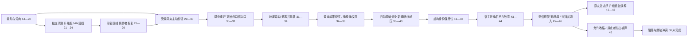

# 待我拼好身体：第21—50章研究与前50章使用谱系

《待我拼好身体，旧日重临人间》，陷阵营营长，book_id `7592279900040465433`。`status=candidate`。复用已验收的[前20章研究](../../nova-eight-stage1-2026-10-11/books/N8_03.md)，本轮逐章全文实读21—50。来源固定于718d853，切片、行段与SHA256见[来源索引](../evidence/chapter-source-index.jsonl)。读者情绪为叙事判断，不是调查结果；操作者徐墨、身体行动者白霏霏、外部人物各自归因。

## 新增逐章实读

| 章 | 困境、选择与反制 | 能力分类与实际行动归属 | 可见兑现、情绪与状态/下一问题 |
| --- | --- | --- | --- |
| [第21章 那姑奶奶放出去半天，搞出这么大的事？](https://github.com/xchhhh22222/nova-source-books/blob/718d853c01c165b4caa0bd0cd812311081578fe9/%E5%BE%85%E6%88%91%E6%8B%BC%E5%A5%BD%E8%BA%AB%E4%BD%93%EF%BC%8C%E6%97%A7%E6%97%A5%E9%87%8D%E4%B8%B4%E4%BA%BA%E9%97%B4%20-%20%E9%99%B7%E9%98%B5%E8%90%A5%E8%90%A5%E9%95%BF.txt#L3303) | 矿区警报逼机构表态；二区怕丢责任先压消息，三区问她是否安全后要求撤回 | 无新能力；白霏霏自主分肉、报告药剂，救助事实与机构利益冲突 | 机构失职让此前胜利失去安全结算；她听到只关注工头之死而愤怒。电话一景可呈现保护伞与救人者不同目标，尚无正式追责 |
| [第22章 魔鬼的低语，你要逼迫这个世界](https://github.com/xchhhh22222/nova-source-books/blob/718d853c01c165b4caa0bd0cd812311081578fe9/%E5%BE%85%E6%88%91%E6%8B%BC%E5%A5%BD%E8%BA%AB%E4%BD%93%EF%BC%8C%E6%97%A7%E6%97%A5%E9%87%8D%E4%B8%B4%E4%BA%BA%E9%97%B4%20-%20%E9%99%B7%E9%98%B5%E8%90%A5%E8%90%A5%E9%95%BF.txt#L3465) | 王旭认为矿工可死，撤回才能甩锅；连锁药剂将蔓延，常规等批准会迟误救援 | 徐墨提供旧知识与升级动机；白霏霏选择无视命令进山。随后徐墨明示抢控制骂王旭，不把骂人归她 | 无力→受诱导但自主接受；两人同去杀怪，前者要经验、后者要救命。药剂原理是徐墨解释，不能视作真实科学；全面救下仍未完成 |
| [第23章 据点来人，背锅的人选](https://github.com/xchhhh22222/nova-source-books/blob/718d853c01c165b4caa0bd0cd812311081578fe9/%E5%BE%85%E6%88%91%E6%8B%BC%E5%A5%BD%E8%BA%AB%E4%BD%93%EF%BC%8C%E6%97%A7%E6%97%A5%E9%87%8D%E4%B8%B4%E4%BA%BA%E9%97%B4%20-%20%E9%99%B7%E9%98%B5%E8%90%A5%E8%90%A5%E9%95%BF.txt#L3615) | 矿区大、夜杀见血有心理风险；白霏霏要求独立战斗，徐墨还身体并睡去 | 旧等级与弱点奖励辅助独立行动；认知滤镜裂纹定位异常是装备，不是徐墨代打。二区带队欲找替罪人 | 独立执行开始而非本章已详演全夜；后半清晨探测到无强畸变、矿工尚活，给清剿间接结果。三区上报与二区压报体现人物利益差异 |
| [第24章 这是可以说的吗？](https://github.com/xchhhh22222/nova-source-books/blob/718d853c01c165b4caa0bd0cd812311081578fe9/%E5%BE%85%E6%88%91%E6%8B%BC%E5%A5%BD%E8%BA%AB%E4%BD%93%EF%BC%8C%E6%97%A7%E6%97%A5%E9%87%8D%E4%B8%B4%E4%BA%BA%E9%97%B4%20-%20%E9%99%B7%E9%98%B5%E8%90%A5%E8%90%A5%E9%95%BF.txt#L3779) | 一夜清剿后身体升级但精神受污染、见死与亲杀感染者折磨，低SAN难交流 | 白霏霏独立完成夜杀；本章未再次进入19章隐藏状态。徐墨睡着未回应。SAN与体力不是同一指标 | 卷刃、血衣、幸存矿工和后来27章22→29级支持战果；不等于所有人获救。她自责且仍搜索，体力收益不能偿还精神代价；二区来接触 |
| [第25章 污蔑与老资历的起床气](https://github.com/xchhhh22222/nova-source-books/blob/718d853c01c165b4caa0bd0cd812311081578fe9/%E5%BE%85%E6%88%91%E6%8B%BC%E5%A5%BD%E8%BA%AB%E4%BD%93%EF%BC%8C%E6%97%A7%E6%97%A5%E9%87%8D%E4%B8%B4%E4%BA%BA%E9%97%B4%20-%20%E9%99%B7%E9%98%B5%E8%90%A5%E8%90%A5%E9%95%BF.txt#L3939) | 女孩直说内城黑幕，罪人身份被查，赵娟利用旧污名及预备假证栽赃 | 她原本尝试解释；徐墨醒来明示夺控制，将赵娟钉跪。无新外挂，变的是执行主体/对规则态度 | 无辜被污蔑→暴力截断指控；只是拒绝受审，并非洗清名誉。第三据点刘文峰出声质疑栽赃规则，但未能阻止接管 |
| [第26章 狗和主人当然应该一起打](https://github.com/xchhhh22222/nova-source-books/blob/718d853c01c165b4caa0bd0cd812311081578fe9/%E5%BE%85%E6%88%91%E6%8B%BC%E5%A5%BD%E8%BA%AB%E4%BD%93%EF%BC%8C%E6%97%A7%E6%97%A5%E9%87%8D%E4%B8%B4%E4%BA%BA%E9%97%B4%20-%20%E9%99%B7%E9%98%B5%E8%90%A5%E8%90%A5%E9%95%BF.txt#L4101) | 徐墨不进入解释框架，承认虚假罪名并虐杀赵娟；刘一手用当众杀同僚重新指控 | 旧操控/装备与暴力；既不查证也不修复法理。白霏霏不适又有罪恶的痛快，担心再无活人 | 指控者死亡是真实战果，不是无罪判决；余人不敢阻止。但行动留下更强真实罪责，操作者泄愤与被操作者安全/道德感不等价 |
| [第27章 难道我没冤枉她？](https://github.com/xchhhh22222/nova-source-books/blob/718d853c01c165b4caa0bd0cd812311081578fe9/%E5%BE%85%E6%88%91%E6%8B%BC%E5%A5%BD%E8%BA%AB%E4%BD%93%EF%BC%8C%E6%97%A7%E6%97%A5%E9%87%8D%E4%B8%B4%E4%BA%BA%E9%97%B4%20-%20%E9%99%B7%E9%98%B5%E8%90%A5%E8%90%A5%E9%95%BF.txt#L4263) | 刘一手悬赏、威逼手下围攻；王旭拒作其枪手。白霏霏想替听命者求情，被徐墨打断 | 徐墨用既有弱点勋章杀人追首领；看到她22→29级，称夜杀为挂机成果。人类杀戮本身不当经验来源 | 以弱胜强的追杀建立，但等级收益来自她夜杀而非他杀同僚；他以处决陷害者作为奖励，她不能决定放过哪些人。外城权力开始崩解 |
| [第28章 【革命者的血液，万紫千红！】](https://github.com/xchhhh22222/nova-source-books/blob/718d853c01c165b4caa0bd0cd812311081578fe9/%E5%BE%85%E6%88%91%E6%8B%BC%E5%A5%BD%E8%BA%AB%E4%BD%93%EF%BC%8C%E6%97%A7%E6%97%A5%E9%87%8D%E4%B8%B4%E4%BA%BA%E9%97%B4%20-%20%E9%99%B7%E9%98%B5%E8%90%A5%E8%90%A5%E9%95%BF.txt#L4413) | 敌33级高于己29级，但药物堆级缺实战；拔枪带来真实威胁，徐墨抢在找枪动作前。万千红到场控制血液中断 | 旧技巧/弱点/先击启动者；不能抗全部子弹。迟缓是万千红的反制，不是主角时停 | 地位高者溃逃→将杀未杀→新强者截断；常规审判又启。群体临时找枪与无能反派降低困境难度，作者自嘲套路不能抵消重复 |
| [第29章 没有解释，我想杀就杀了！](https://github.com/xchhhh22222/nova-source-books/blob/718d853c01c165b4caa0bd0cd812311081578fe9/%E5%BE%85%E6%88%91%E6%8B%BC%E5%A5%BD%E8%BA%AB%E4%BD%93%EF%BC%8C%E6%97%A7%E6%97%A5%E9%87%8D%E4%B8%B4%E4%BA%BA%E9%97%B4%20-%20%E9%99%B7%E9%98%B5%E8%90%A5%E8%90%A5%E9%95%BF.txt#L4557) | 万千红要求解释杀同僚；徐墨拒讲案情，准备打她。白霏霏因恩情想保她命却无身体决定权 | 无新增能力；旧剧情经验被徐墨用来否定调查意义。断臂母亲主动喊出反证，万千红压刘一手让其说 | 白霏霏让保护者失望的酸楚→受救者发言开希望；翻盘入口来自第三人的冒险，而非操作者全知。还未完成证词查验 |
| [第30章 魔手佛心，念头通达](https://github.com/xchhhh22222/nova-source-books/blob/718d853c01c165b4caa0bd0cd812311081578fe9/%E5%BE%85%E6%88%91%E6%8B%BC%E5%A5%BD%E8%BA%AB%E4%BD%93%EF%BC%8C%E6%97%A7%E6%97%A5%E9%87%8D%E4%B8%B4%E4%BA%BA%E9%97%B4%20-%20%E9%99%B7%E9%98%B5%E8%90%A5%E8%90%A5%E9%95%BF.txt#L4715) | 原本被抓做假证的受救者指认药剂、分肉、威胁口供；万千红用血液能力辅助判断，开始救治调查 | 白霏霏先前善举生成证人行动；母亲自主反抗、万千红愿听共同改因果。徐墨趁放松飞刀杀刘一手 | 受压者替恩人说话完成关系/身份兑现；徐墨自己也意外。随后泄愤偿还他个人期待，却毁掉审讯入口。清剿、辨冤和报复是三种结果，不能混成单一无损胜利 |
| [第31章 地底暴动，怎么时间提前了？](https://github.com/xchhhh22222/nova-source-books/blob/718d853c01c165b4caa0bd0cd812311081578fe9/%E5%BE%85%E6%88%91%E6%8B%BC%E5%A5%BD%E8%BA%AB%E4%BD%93%EF%BC%8C%E6%97%A7%E6%97%A5%E9%87%8D%E4%B8%B4%E4%BA%BA%E9%97%B4%20-%20%E9%99%B7%E9%98%B5%E8%90%A5%E8%90%A5%E9%95%BF.txt#L4853) | 刘一手死，万千红失去调查突破口；地底暴动使探查者吴鑫七窍流血、仪器碎裂。徐墨认出灾难前兆但时序提前 | 旧游戏经验与SAN面板提示撤退；万千红下令带平民走。异常暴动提前原因未知，不宣称杀刘直接引发 | 个人复仇结束→集体灾难恐惧；撤离未额外伤亡是局部生存结果，矿底未解决。徐墨以游戏结局称城必亡是经验判断，非已发生事实 |
| [第32章 万千红：你这样我有点害怕](https://github.com/xchhhh22222/nova-source-books/blob/718d853c01c165b4caa0bd0cd812311081578fe9/%E5%BE%85%E6%88%91%E6%8B%BC%E5%A5%BD%E8%BA%AB%E4%BD%93%EF%BC%8C%E6%97%A7%E6%97%A5%E9%87%8D%E4%B8%B4%E4%BA%BA%E9%97%B4%20-%20%E9%99%B7%E9%98%B5%E8%90%A5%E8%90%A5%E9%95%BF.txt#L5007) | 需要疏散矿工、留尸取证、上报扎营；徐墨怕耗尽控制时间还身体 | 明示旧控制限时仍被考虑。万千红独立调度机构资源；白霏霏自愿帮忙、为冒犯道歉但被安排休息 | 人物性情突变让机构更困惑；他制造的危险名声让她难正常贡献。她没有新职级认证；暂驻而非正式获释无罪 |
| [第33章 邪神的所有馈赠，早已在暗中标好价格](https://github.com/xchhhh22222/nova-source-books/blob/718d853c01c165b4caa0bd0cd812311081578fe9/%E5%BE%85%E6%88%91%E6%8B%BC%E5%A5%BD%E8%BA%AB%E4%BD%93%EF%BC%8C%E6%97%A7%E6%97%A5%E9%87%8D%E4%B8%B4%E4%BA%BA%E9%97%B4%20-%20%E9%99%B7%E9%98%B5%E8%90%A5%E8%90%A5%E9%95%BF.txt#L5131) | 女孩要救城、问徐墨目的；他想重塑自己身体并继续游戏，故意声称馈赠标价制造恐惧促练级 | 她接受未知代价不证明真实契约。她沉睡后徐墨发现自动接管且不限时：新条件/限制放宽，不是旧战术；19章未知状态未解释 | 不安→视死如归式接受；信息不对称扩大。睡眠使操作者生活自由增加，却使她无法监督，能力边界被削弱而非双方真诚信任增长 |
| [第34章 你要睡我？也不是不行](https://github.com/xchhhh22222/nova-source-books/blob/718d853c01c165b4caa0bd0cd812311081578fe9/%E5%BE%85%E6%88%91%E6%8B%BC%E5%A5%BD%E8%BA%AB%E4%BD%93%EF%BC%8C%E6%97%A7%E6%97%A5%E9%87%8D%E4%B8%B4%E4%BA%BA%E9%97%B4%20-%20%E9%99%B7%E9%98%B5%E8%90%A5%E8%90%A5%E9%95%BF.txt#L5303) | 万千红调查尸体/矿工确认夜杀功绩，给奖励与私人赔礼；内城要求撤换探查，地方调查将被打断 | 到账10万、加300贡献到306、金滤镜实到。徐墨收取，战功主要由白霏霏夜杀；剧情预判知道替换 | 救助转制度认可与装备，不能记成徐墨战功。床边误会/玩笑是气氛变化而非性关系实成。奖励保SAN但未知矿底压力仍在 |
| [第35章 边缘行者算个J B ！](https://github.com/xchhhh22222/nova-source-books/blob/718d853c01c165b4caa0bd0cd812311081578fe9/%E5%BE%85%E6%88%91%E6%8B%BC%E5%A5%BD%E8%BA%AB%E4%BD%93%EF%BC%8C%E6%97%A7%E6%97%A5%E9%87%8D%E4%B8%B4%E4%BA%BA%E9%97%B4%20-%20%E9%99%B7%E9%98%B5%E8%90%A5%E8%90%A5%E9%95%BF.txt#L5505) | 徐墨解读老师不回电话为默认撑腰，教万千红用裁量权不退；她下令收容矿工、关押工头，吴锦衣到来逼交接 | 旧知识/政治判断与普通语言；先知暗示是徐墨推断，未有老师确认。她自己选择留下并承担职位冲突 | 被动受令→主动护辖区；共同目标由行动而非口号形成。主角授策让机构选边，但“靠杀”口号未等于全案正义成功 |
| [第36章 我都嚣张几辈子了，不劳你费心](https://github.com/xchhhh22222/nova-source-books/blob/718d853c01c165b4caa0bd0cd812311081578fe9/%E5%BE%85%E6%88%91%E6%8B%BC%E5%A5%BD%E8%BA%AB%E4%BD%93%EF%BC%8C%E6%97%A7%E6%97%A5%E9%87%8D%E4%B8%B4%E4%BA%BA%E9%97%B4%20-%20%E9%99%B7%E9%98%B5%E8%90%A5%E8%90%A5%E9%95%BF.txt#L5707) | 吴锦衣以边缘行者/罪人施压；徐墨把命令归属公开化，万千红明确保关键调查者 | 徐墨操控、扯已有先知背景、逼说明授权；他自身没有先知身份。万千红独立公开担保使保人有效 | 言语掌控与机构扬眉吐气；撤换未就此正式撤销，对手改打参与资格。翻盘靠她承担政治责任，非主角辱骂即有通用免罚能力 |
| [第37章 比斗，学院派的顶级天才？](https://github.com/xchhhh22222/nova-source-books/blob/718d853c01c165b4caa0bd0cd812311081578fe9/%E5%BE%85%E6%88%91%E6%8B%BC%E5%A5%BD%E8%BA%AB%E4%BD%93%EF%BC%8C%E6%97%A7%E6%97%A5%E9%87%8D%E4%B8%B4%E4%BA%BA%E9%97%B4%20-%20%E9%99%B7%E9%98%B5%E8%90%A5%E8%90%A5%E9%95%BF.txt#L5857) | 敌援重大任务不得三级以下参加，以23级学院天才提挑战；自身29级被罪人/一级职级遮蔽 | 游戏等级显示提供选择信息；徐墨接比斗，先问若杀会否扯皮。公共职级与体魄等级分离，无新GF | 看穿不对等挑战→等兑现；实际非必死危机，是对手误判的公开验实力。吴许对方杀伤免责任，规则有利益偏向 |
| [第38章 分身？什么路边一条](https://github.com/xchhhh22222/nova-source-books/blob/718d853c01c165b4caa0bd0cd812311081578fe9/%E5%BE%85%E6%88%91%E6%8B%BC%E5%A5%BD%E8%BA%AB%E4%BD%93%EF%BC%8C%E6%97%A7%E6%97%A5%E9%87%8D%E4%B8%B4%E4%BA%BA%E9%97%B4%20-%20%E9%99%B7%E9%98%B5%E8%90%A5%E8%90%A5%E9%95%BF.txt#L6019) | 李岩分身围攻；徐墨本可逐一打，发现弱点勋章只标真身，投刀解决，刻意没杀 | 旧弱点显示新用：从找器官变识真身；旧金属手环作飞刀。不是新发反幻术外挂 | 分身消失、真身受伤与资格证明可视化；吴脸面丢失。大量群嘲+一击残害与前轮相似，敌低6级，困难程度低，不能包装越级绝境 |
| [第39章 你压力的是白霏霏，和我有什么关系？](https://github.com/xchhhh22222/nova-source-books/blob/718d853c01c165b4caa0bd0cd812311081578fe9/%E5%BE%85%E6%88%91%E6%8B%BC%E5%A5%BD%E8%BA%AB%E4%BD%93%EF%BC%8C%E6%97%A7%E6%97%A5%E9%87%8D%E4%B8%B4%E4%BA%BA%E9%97%B4%20-%20%E9%99%B7%E9%98%B5%E8%90%A5%E8%90%A5%E9%95%BF.txt#L6163) | 61级李鬼隐身出场欲接管，徐墨通过界面等级先见并不认识此人；李鬼打吴，非替主角报仇 | 旧等级界面揭不可见人，是感知显示新场景；不认识挑战“全知”。边缘遁术是敌独立能力 | 更强威胁抬高；徐墨猜李岩爷爷，被对方否认，不建立亲缘事实。主角又骂，引恶意气场；真正战斗未发生 |
| [第40章 多方汇聚，游骑兵，白羊！](https://github.com/xchhhh22222/nova-source-books/blob/718d853c01c165b4caa0bd0cd812311081578fe9/%E5%BE%85%E6%88%91%E6%8B%BC%E5%A5%BD%E8%BA%AB%E4%BD%93%EF%BC%8C%E6%97%A7%E6%97%A5%E9%87%8D%E4%B8%B4%E4%BA%BA%E9%97%B4%20-%20%E9%99%B7%E9%98%B5%E8%90%A5%E8%90%A5%E9%95%BF.txt#L6321) | 李鬼气势压迫众人，徐墨却无反应，因为作用于宿主、宿主沉睡。洪九闯入把对手注意转走 | 双主体+新睡眠条件绕开压力；不是29级肉体胜61级。洪九68级及火遁是第三方独立介入 | 不低头/威压失效与嘲老反差成立；化解余险还需洪九出现，不能归主角战胜李鬼。没有证据沉睡免疫一切物理损害 |
| [第41章 社会上混，身份都是自己给的](https://github.com/xchhhh22222/nova-source-books/blob/718d853c01c165b4caa0bd0cd812311081578fe9/%E5%BE%85%E6%88%91%E6%8B%BC%E5%A5%BD%E8%BA%AB%E4%BD%93%EF%BC%8C%E6%97%A7%E6%97%A5%E9%87%8D%E4%B8%B4%E4%BA%BA%E9%97%B4%20-%20%E9%99%B7%E9%98%B5%E8%90%A5%E8%90%A5%E9%95%BF.txt#L6461) | 游骑兵因异常寻收容物而来；洪九招揽，万千红紧张怕失同伴。徐墨不愿接受，对其理念反攻 | 旧世界/组织知识与临场利用，无新GF/真实加入；第三方由资源目标来而非主角召唤 | 更强者从威胁转邀请，新可选组织接口；主角继续骂任何人产生局部喜感，也逼读者等待如何留队。不把称兄弟当所有关系永久友好 |
| [第42章 假面神隐会，我给你接了个大活](https://github.com/xchhhh22222/nova-source-books/blob/718d853c01c165b4caa0bd0cd812311081578fe9/%E5%BE%85%E6%88%91%E6%8B%BC%E5%A5%BD%E8%BA%AB%E4%BD%93%EF%BC%8C%E6%97%A7%E6%97%A5%E9%87%8D%E4%B8%B4%E4%BA%BA%E9%97%B4%20-%20%E9%99%B7%E9%98%B5%E8%90%A5%E8%90%A5%E9%95%BF.txt#L6611) | 徐墨现编组织与收邪神尸体理念，洪九被唬；再次地震各队扎营，撤换不了了之 | 临场虚构身份/话术，旧知识做可信外观；不存在真实组织战力或已收容邪神。事件打断也是结果条件 | 调查席位保留、东区改敬佩是身份收益；不是正式裁定撤销命令。给她建立名声同时接下危险活，白霏霏尚未知情 |
| [第43章 赫赫威名，你到底用我的身体干什么了？！](https://github.com/xchhhh22222/nova-source-books/blob/718d853c01c165b4caa0bd0cd812311081578fe9/%E5%BE%85%E6%88%91%E6%8B%BC%E5%A5%BD%E8%BA%AB%E4%BD%93%EF%BC%8C%E6%97%A7%E6%97%A5%E9%87%8D%E4%B8%B4%E4%BA%BA%E9%97%B4%20-%20%E9%99%B7%E9%98%B5%E8%90%A5%E8%90%A5%E9%95%BF.txt#L6777) | 睡十余小时SAN回满，徐墨告知已替她接矿底任务；外人让队、道歉、李岩怒视，她不认识 | 睡眠回SAN按本章说明属玩家角色能力，本轮新明示恢复条件；白霏霏自主日常，继承他社会后果 | 他以人设作保护，她感信息缺口；软收益真实表现是让位/保镖/道歉，不止群体惊讶。另一个主体替她授权未等于知情同意 |
| [第44章 你的攻击性我认可了](https://github.com/xchhhh22222/nova-source-books/blob/718d853c01c165b4caa0bd0cd812311081578fe9/%E5%BE%85%E6%88%91%E6%8B%BC%E5%A5%BD%E8%BA%AB%E4%BD%93%EF%BC%8C%E6%97%A7%E6%97%A5%E9%87%8D%E4%B8%B4%E4%BA%BA%E9%97%B4%20-%20%E9%99%B7%E9%98%B5%E8%90%A5%E8%90%A5%E9%95%BF.txt#L6943) | 叶瑜讲昨夜，她发现得罪两强者；自行问任务、两队为何分开。吴警告，她因真不认识问是谁 | 独立获取缺失信息，而非徐墨代打；回应被徐墨赞为攻击性但她动机不是羞辱。未复制彼此动机 | 炫威爽→女孩崩溃与担责；理清周期3—4小时为入矿准备。叶瑜说游骑兵被吓退是夸赞，实际42章还有地震/要事，不能当已证因果 |
| [第45章 我数五个数，让他们先趟个雷](https://github.com/xchhhh22222/nova-source-books/blob/718d853c01c165b4caa0bd0cd812311081578fe9/%E5%BE%85%E6%88%91%E6%8B%BC%E5%A5%BD%E8%BA%AB%E4%BD%93%EF%BC%8C%E6%97%A7%E6%97%A5%E9%87%8D%E4%B8%B4%E4%BA%BA%E9%97%B4%20-%20%E9%99%B7%E9%98%B5%E8%90%A5%E8%90%A5%E9%95%BF.txt#L7093) | 万千红愿保护她留外，女孩因责任/可帮他人选择进；内城先入，徐墨让等，把对手当探雷 | 旧未来经验指挥，她喊停，靠此前人设取得队伍暂停；倒数到零没发生，精确预言先失败 | 护人目的与利用他人死的策略冲突；她冷汗，不是戏谑共谋。任务竞争/毁证担忧迫使万千红想赶路，反制有真实目标来源 |
| [第46章 叛逆少女的仰慕](https://github.com/xchhhh22222/nova-source-books/blob/718d853c01c165b4caa0bd0cd812311081578fe9/%E5%BE%85%E6%88%91%E6%8B%BC%E5%A5%BD%E8%BA%AB%E4%BD%93%EF%BC%8C%E6%97%A7%E6%97%A5%E9%87%8D%E4%B8%B4%E4%BA%BA%E9%97%B4%20-%20%E9%99%B7%E9%98%B5%E8%90%A5%E8%90%A5%E9%95%BF.txt#L7261) | 数秒后超周期地震，部分先入者被埋；徐墨明确仅经验非确定，要求非己方牺牲。万千红开始问她怎么做 | 旧知识不精确但时序选择避灾；白霏霏传令，非操控地震。金滤镜仍颤/SAN下降，装备没抹风险 | 集体避免入口坍塌→发言权上升，另一队损伤/叶瑜崇拜追入导致新责任。经验判断失准细节不能被旁观者“精准”夸赞覆盖 |
| [第47章 输出可以不打，但人头要抢！](https://github.com/xchhhh22222/nova-source-books/blob/718d853c01c165b4caa0bd0cd812311081578fe9/%E5%BE%85%E6%88%91%E6%8B%BC%E5%A5%BD%E8%BA%AB%E4%BD%93%EF%BC%8C%E6%97%A7%E6%97%A5%E9%87%8D%E4%B8%B4%E4%BA%BA%E9%97%B4%20-%20%E9%99%B7%E9%98%B5%E8%90%A5%E8%90%A5%E9%95%BF.txt#L7401) | 叶瑜要摆脱镀金、自主参与；女孩担心他制造崇拜害人。大量尸怪来袭，徐墨要抢人头，宿主要杀异常 | 旧弱点勋章由白霏霏独立用来补刀/救叶；徐墨只提供方案。输出可由队友承担，经验条件是本人最后击杀 | 救助与利益同场发生；最初感谢真实，后来过度补刀引疑。叶有自主动机而非被能力控制，团队接纳依赖其表达与实际战斗 |
| [第48章 心里变态的话，可以接受一下辅导](https://github.com/xchhhh22222/nova-source-books/blob/718d853c01c165b4caa0bd0cd812311081578fe9/%E5%BE%85%E6%88%91%E6%8B%BC%E5%A5%BD%E8%BA%AB%E4%BD%93%EF%BC%8C%E6%97%A7%E6%97%A5%E9%87%8D%E4%B8%B4%E4%BA%BA%E9%97%B4%20-%20%E9%99%B7%E9%98%B5%E8%90%A5%E8%90%A5%E9%95%BF.txt#L7535) | 高级队友不需救也被抢，渐让最后击杀；一波30级，主角承认精神不稳掩秘密，万同情。旧尸采证、两人联探 | 旧经验收益，29→30已验证；三级体魄非已完成职业升职。言灵只是想找尚未获得；吴/万联探为独立能力 | 成长舒爽与被误认为病人对冲；队友配合有成本但无经验损失（来源角色说法）。尸体/创口证据推动调查，不能只计击杀数字 |
| [第49章 人设的神奇效果](https://github.com/xchhhh22222/nova-source-books/blob/718d853c01c165b4caa0bd0cd812311081578fe9/%E5%BE%85%E6%88%91%E6%8B%BC%E5%A5%BD%E8%BA%AB%E4%BD%93%EF%BC%8C%E6%97%A7%E6%97%A5%E9%87%8D%E4%B8%B4%E4%BA%BA%E9%97%B4%20-%20%E9%99%B7%E9%98%B5%E8%90%A5%E8%90%A5%E9%95%BF.txt#L7687) | 徐墨先选塌道却故意等吴冒险探查后才反对，女孩尴尬传令；众人凭先前战果接受，后有质疑 | 旧地图经验+由人设积累的信任/恐惧，不能仅当神谕自动通行；杨硕独立救触毒箭的吴 | 女孩意识发言效率提高，吴的付出被弃伤尊严；众人搬石成本真实。遇四行动队员证方向非空，但尚未证明全部路线最优；回忆把第二据点误写第三据点，保留源误不修剧情 |
| [第50章 请让一下吧，这是我最后给你的机会了](https://github.com/xchhhh22222/nova-source-books/blob/718d853c01c165b4caa0bd0cd812311081578fe9/%E5%BE%85%E6%88%91%E6%8B%BC%E5%A5%BD%E8%BA%AB%E4%BD%93%EF%BC%8C%E6%97%A7%E6%97%A5%E9%87%8D%E4%B8%B4%E4%BA%BA%E9%97%B4%20-%20%E9%99%B7%E9%98%B5%E8%90%A5%E8%90%A5%E9%95%BF.txt#L7843) | 队员在高台设毒箭称防怪，拒解释并要东区另走；女孩要求炸地，敌情绪骤变以安全指控反对 | 徐墨知路指此、提议稍后接管；身体末尾已持刀攻击，但未明示完成切换，操控归属`UNKNOWN`，不只凭口吻认定 | 礼貌最后机会→动作开战；安全反对有矿体脆弱条件，敌变色不等于完整阴谋已证。未杀完/未炸开/未发现核心物；所有胜利与真相承诺保留到后续审核 |

## 三个阶段的机制判断

21—30：清剿救人是白霏霏独立行动，升级没有改善SAN；弱身体限制转为精神与制度压力。徐墨的旧弱点/技巧能打断围捕，不能代替受害者主动作证。30章第一次重要关系回收偿还14—20章救母女、给肉的善举；同章飞刀又让办案者失去口供。情绪由母亲愤怒、万千红愿听、徐墨急于报复分别推动。不是隐藏能力救场；夜杀未复现19章隐藏状态。24—29低SAN的实际损耗支持约束，25—28反派无能/栽赃多章拖延削弱真实难度。

31—40：个人事件扩为城市灾难/机构管辖。旧面板读SAN预警，控时约束32仍在；33沉睡不限操控成为新条件，40又绕过精神威压，两者降低早期限制。旧勋章识真身38是真实新用，35—36政治授策与盟友担保是普通策略/关系接口，不能记新外挂。37—38不是什么必死危机：敌比己低级、主角还先问能否杀。奖励34到账、金滤镜到手有来源行为；“老师失联暗示撑腰”还只是徐墨判断。矿底暴动与城灭因果33明确不确定，必须保留。

41—50：虚构高位理念保住席位，不等于拥有组织。宿主继承敌意且缺信息，形成胜利后新问题；她自主问询、选进矿、独立补刀。旧经验避灾不是精准预知，45倒数落空；此前关系让队伍肯等待/改路，49把软收益转换为决策权。48成长同时造成病理误认，资源/关系没有简单同向上涨。50新对抗尚开头，不补齐第三次矿底高潮。多次“你是谁”、骂人、围观、被误认性情异常已经有疲劳；自主行动与他人情绪改变的代价仍能产生变化。

## 连续剧情循环图

箭头分级：A→D、I→J、J→K、K→M有明确后续行为/对白绑定；地底异动只是时序连接E→F，原因未证，不能认为复仇触发地震。H→I中洪九独立来矿为资源目标，不是徐墨的控制产物。

## 可复核循环卡

| 字段 | 循环Ⅰ21—24：自主清剿 | 循环Ⅱ25—31：暴力与证言 | 循环Ⅲ34—38：留调查席位 | 循环Ⅳ39—44：反威压与人设 | 循环Ⅴ45—46：经验避灾 | 循环Ⅵ47—50：团队经验/决策（末段开放） |
| --- | --- | --- | --- | --- | --- | --- |
| 来源 | 《待我拼好身体，旧日重临人间》 / 7592279900040465433 / 21—24 | 《待我拼好身体，旧日重临人间》 / 7592279900040465433 / 25—31，回收14—20 | 《待我拼好身体，旧日重临人间》 / 7592279900040465433 / 34—38 | 《待我拼好身体，旧日重临人间》 / 7592279900040465433 / 39—44，条件33 | 《待我拼好身体，旧日重临人间》 / 7592279900040465433 / 45—46，信任42 | 《待我拼好身体，旧日重临人间》 / 7592279900040465433 / 47—50 |
| 初始困境 | 多点感染等许可会迟救 | 救人者被污名，真相不被听 | 抢走管辖即失继续查权限 | 级差/压力无法硬战，身体名声外包 | 常规周期判定失效；赶路怕毁证 | 独力成长慢；普通感知失败且有阻路者 |
| 压力来源 | 机构甩锅、扩散、良心与SAN | 地位、假证、围攻、强者中止 | 上级口径、身份门槛、公众资格 | 高阶威压、招揽、宿主失知情权 | 不精确知识、敌先入、他人可能牺牲 | 最后一击竞争、秘密、团队成本 |
| 金手指功能 | 等级成长、旧弱点支持宿主行动 | 操作者旧技巧弱点；不负责证言 | 等级界面判断；弱点唯一标真身 | 等级显示；睡眠免操控限时的新条件绕精神压迫 | 旧经历提供顺序线索非确定倒计时 | 弱点支持补刀，最后击杀产经验；旧地图指路 |
| 主角行动 | 少女独立夜杀，他只引导目标 | 他报复，少女此前救人，母亲冒险说真话 | 他授策接比斗；万独立担保 | 他拒招揽虚构身份；少女醒后问询 | 他让等，她拦己方；万愿听 | 他建议/指定；她独立补刀并替选择担发言责任 |
| 对手或环境反制 | 夜杀精神耗尽且仍有人来不及救 | 强者控制血液、同僚杀人真实指控 | 吴改用实测资格，分身包围 | 61级施压；名声为宿主带未知敌意 | 旧记忆计时不准，地震破周期 | 队友先疑，探测相反，毒箭/安全指控 |
| 翻盘关键 | 不等体制许可，救助速度压扩散 | 武力保即时生存，证言重开调查，两步不同主体 | 权限者扛责任，旧勋章破对手信息伪装 | 绕压力对象＋第三方介入；理念外观改注意焦点 | 不是精确预测，而是先让别人进入、己方延迟 | 团队输出与末击解耦；信任换改路，阻路尚未翻盘 |
| 情绪变化 | 无力→行动坚定→悲痛/自责 | 不公→报复痛快→恩情回流→再出伦理代价 | 憋屈→站队→公开掌控/资格认可 | 压迫→反差好笑→宿主惊慌 | 紧迫→落空尴尬→避灾震撼/不安 | 成长快感→被当病人→信任喜悦/对弃付出尴尬 |
| 具体兑现 | 畸变尸体、存活矿工、22→29级 | 母亲证词、万下令救治调查；刘死但口供没了 | 10万/贡献/滤镜实到；李岩真身受伤分身灭 | 暂保席位、他人道歉让队；不是击杀两强者 | 己队未入坍洞，部分敌队受损；不是全体救下 | 29→30级、让击杀、众人搬石随路；50只开始攻击 |
| 状态变化 | 更强身体/更低SAN，调查风险 | 恩情外显、同僚死、调查突破口损失 | 地方盟友、参与资格、保护装备 | 宿主敬畏人设与敌意同时增；信息不对称 | 发言权更强；叶自行追入成新责任 | 成长、病理误认、事实带路权、队伍负担 |
| 下一循环 | 罪人身份被用于背锅 | 地底异动另开灾难，不证复仇所致 | 更高阶/第三方争同一资源 | 宿主要承担他替定的任务与外部关系 | 几方分线探查，队友/学生进入 | 高台阻路、地下秘密/爆破是否可行待51以后 |
| 原创借鉴 | 能力收益不抹心理成本 | 过去帮助产生主动证人，武力不包名誉 | 独立权限者与执行者互保，不虚设后台 | 胜利外观能外溢为另一人信息负债 | 有误差的信息靠保守顺序选择生存 | 收益归属变化会重塑合作；被让出成果也有误认成本 |
| 独立疲劳风险 | 杀怪刷级配苦难重复，无救助差别 | 反派串栽赃/嘴炮，再虐杀；证人巧得被抓到场 | 低级学生被吹天才，资格白送 | 每个高阶都无脑吃骂，新睡眠让限时失效 | 经验每次都碰巧对，沉默外观伪成精准 | 队友无代价让收益、误认只当笑话、指路永不失败 |

## 前50章金手指使用谱系（累积，不重拆前20）

| 能力/条件 | 首现/旧证据 | 21—50新用途、边界与归属 | 分类 |
| --- | --- | --- | --- |
| 操控身体、老玩家战斗/剧情经验 | 1—2；5—10协商，16抢枪 | 22骂命令、25—30反围捕；35—36授策；45—46避灾；49地图。不同场景不等于新功能 | 旧能力/普通决策；经验不是全知 |
| 有限回档 | 3—4，剩10次 | 新30章未展示再次回档；不能说次数刷新/无限复活/已经耗尽 | 旧功能未用，额度沿用旧记录不推新数 |
| 弱点勋章 | 10所得、11/19验证 | 27—28精准取要害；38只真身有标记破分身；47宿主自行识弱补刀 | 旧奖励新用途，有可观察结果 |
| 升级经验 | 1—20杀异常，不杀普通人取经验 | 24/27独立夜杀22→29；48集体输出她末击29→30 | 旧奖励规则/硬成长；战果分别归两人 |
| SAN面板与装备 | 前期压力、19止跌隐藏状态、13铜滤镜 | 24精神受损；31读低SAN撤；34金滤镜送达；46仍掉SAN | 旧状态/新装备，不是永久免疫 |
| 19章隐藏战斗状态 | 首阶段未知 | 24明示未再进入；21—50未解释机制、不用它替后续战果归因 | UNKNOWN，不能当已控旧能力 |
| 操控时间 | 前期有效；19到限 | 32明确退出保剩时间；33宿主沉睡不限时；40因宿主睡精神压力失效 | 新明示条件/限制放宽，不虚构正式解锁提示 |
| 睡眠回SAN | 本轮43解释 | 她睡十余小时回满，心理负面扫除；不代表伤口/法律责任随睡重置 | 新明示恢复条件；未确认此前早章也规定它 |
| 金属手环等旧装备 | 前阶段黄家豪所得 | 26变短剑、38变飞刀，未赋新永久技能 | 旧装备形变输出 |
| 可见等级与显示位置 | 旧界面 | 37知23级、39在空地看到61级标记；无万能识破敌地图/背景 | 旧显示新环境 |
| 人设/信任/恩情 | 少女14—20救助；机构已有接触 | 30证人、34奖励、36担保、43让队、45愿停、49愿随路线 | 软收益/关系资源，非GF自动忠诚 |
| 言灵、自身实体重塑、矿底物品 | 前期目标/世界知识 | 48只是想找言灵；50未取得矿底物；重塑条件33仍高 | 未兑现承诺，不记新能力 |

## 能力约束、责任和未付承诺

操控时间：32为有效限制，33增加“宿主精神沉睡”不限时，40进一步无惧作用于睡宿主的气场。本文不替来源补“睡眠不能战斗”等限制；34—42他已活动/参加比斗，说明此阶段身体并未因宿主睡而静止。物理伤害免疫、沉睡代价与是否每夜都能无限操作未知。SAN24真实影响少女行动，43睡满恢复能降低长尾精神债，但45—46再入场继续掉说明并非永久取消污染。

决定权：23她请求自主夜杀并实际执行；25无预先同意被接管；33故意隐瞒操作者动机；42—43她在未知情况下被接新任务；45她又自主决定参与，不能以后一次愿意覆盖前一次未知情。49她照命令对抗刚付出身体代价的探查者，责任在社会层面落在她身上。50末尾没有“谁接管”明句，保留UNKNOWN。原文49将其早前屠杀据点误写第三据点，与25—30第二据点事件不同；不静默修原著。

等级回述也保留口径缺口：第一阶段20章记录为21级，本轮27章回述夜杀从22到29；21—23新增研究未核实明确补升到22的节点，不补造升级动作。夜杀后29与48升30都有明示，但跨阶段起点不可因此强行统一。

截至50章已兑现：弱体考核与纠错（沿用阶段一）、部分救助、恩人被证人维护、夜杀奖励、留下调查位置、旧弱点破分身、避一次入口坍塌、她到30级、实际路线决定权。未付：她真正知情的共存边界、19隐藏状态、徐墨实体身体、曙光城能否救、矿底异常与药剂保护网全案、言灵、地板下真相/战斗/爆破。没有将“开始查”写成“罪恶清算完成”。

## 首次高潮后的疲劳与继续建议

最值得学的是30章“他看不起的善举产生他预判之外的证人行动”，以及42—49“社会名声提高决策效率却将成本交给另一个人”。它们改变结果归属和决定权，非只换反派。最应警惕的是25—30栽赃与拒解释拉长、36—42接连嘴炮群体发愣、43—44不认识被当羞辱、48怪癖被当病，精神疾病只当笑料可能让情绪失真。33新条件与19未知天赋一起削弱受限设计，不可当强机制的免费补丁。

`CONTINUE_TO_100_RECOMMENDATION=CONDITIONAL_PRIORITY_1`：值得优先独立审核后继续，目标是检验调查/救城宏弧、主体自主与控制后果，非堆更多辱骂。100章继续的最低研究收益应包含至少一轮少女的独立目标改变徐墨路线、一次名声或隐瞒真正付代价，并核清无限睡眠操控边界；若全部靠未知能力/全知压场，则停止。此结论不是进入51章授权。
